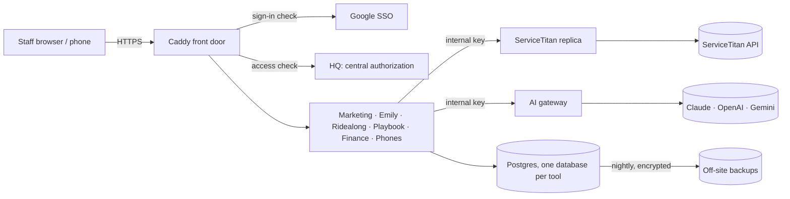

# Shayn Hornik: Portfolio

I co-founded **Honey Go Fix It**, a plumbing and home-services company in Dayton, Ohio, and I build the software that runs it.
Most of that software is private because it runs a real business with real customer data. This repo is the public
record of it: what each system does, how it is built, and the engineering problems behind it. The source stays closed,
but the details here are specific enough to discuss line by line in an interview.

**[shaynhornik.com](https://shaynhornik.com)** · **[GitHub](https://github.com/shaynhornik)** · Ohio, US

---

## At a glance

| | |
|---|---|
| **Internal platform** | A self-hosted suite of about ten web apps, three Android apps and shared infrastructure that replaced several paid SaaS products at HGFI: one Google sign-in, one access-control service, one design system |
| **Scale** | ~495 commits and ~195k lines across 12 private repos for the current suite (Sept 17 to Oct 11, 2026), plus an earlier production KPI and payroll platform (Feb to Sep 2026, 110 commits, ~40k lines) |
| **Testing** | About 1,400 automated tests across the suite, plus end-to-end tests that place real phone calls and drive real browsers |
| **Integrations** | 30+ external APIs: QuickBooks Online, Ramp, Plaid, ServiceTitan, Housecall Pro, Telnyx (voice, WebRTC, SIP, 10DLC SMS), Deepgram, Amazon SES/SNS, Anthropic Claude, OpenAI, Gemini, Google Workspace, Gmail, Firebase, Meta, Garmin and more |
| **Open source** | 8 pull requests merged into 4 outside projects, including two Apache Software Foundation projects ([details](OPEN-SOURCE.md)) |
| **How I build** | I design the systems, write the specs and business rules, and ship with AI pair-programming (Claude Code), with tests and safety gates as the contract ([details](HOW-I-BUILD.md)) |

---

## Featured systems

### The HGFI Tools platform (Sept to Oct 2026, private)

| System | What it does | Status | Case study |
|---|---|---|---|
| **HGFI Tools platform** | The shared foundation: SSO, central authorization, design system, Postgres per tool, encrypted backups, safe deploys | In production | [01](case-studies/01-hgfi-tools-platform.md) |
| **ServiceTitan replica** | Keeps a read-only copy of 135 ServiceTitan data sources in Postgres; guarded, dry-run-first write layer; 31 ms phone lookups | Running on the live tenant | [02](case-studies/02-servicetitan-replica.md) |
| **Finance** | Job costing across Ramp and QuickBooks Online, receipts read by Claude, card charges matched to jobs, bank data via Plaid | Internal, real data | [03](case-studies/03-finance-job-costing.md) |
| **Books rebuild** | Python toolkit that rebuilt the company's books from 2022 and reconciles every account to its statements, line by line | Ongoing | [04](case-studies/04-books-rebuild.md) |
| **Analyst kit** | Lets a non-programmer office manager ask Claude Code business questions over production data, read-only by construction | In use | [05](case-studies/05-analyst-kit.md) |
| **Phone system + Android app** | A company phone system on Telnyx (call engine, browser softphone, recordings, transcripts) and a native Kotlin calling app | Pilot | [06](case-studies/06-phone-system.md) |
| **Emily** | AI office assistant for after-hours calls and email, with hard guardrails in code and a golden-conversation deploy gate | Staging | [07](case-studies/07-emily-ai-assistant.md) |
| **AI gateway** | One internal API in front of Anthropic, OpenAI, Gemini and OpenRouter: per-job model routing, fallbacks, schema checks, cost ledger | Live | [08](case-studies/08-ai-gateway.md) |
| **Ridealong** | Records in-home visits on Android, transcribes them with speaker labels, and scores them with evidence-quoted AI coaching | In use by the field team | [09](case-studies/09-ridealong.md) |
| **Marketing platform** | In-house email (Amazon SES, replaced Mailchimp), 10DLC texting, SEO tracking, lead scoreboard, public booking page | In production since Oct 5 | [10](case-studies/10-marketing-platform.md) |
| **Playbook** | Policies, SOPs and training with sign-offs pinned to the exact version read | Pilot, all staff | [11](case-studies/11-playbook.md) |

### Earlier work and personal projects

| Project | What it is | Case study |
|---|---|---|
| **Performance Center** | KPI, commission and payroll platform for field technicians; ran in production Feb to Sep 2026 | [12](case-studies/12-performance-center.md) |
| **Owning the website** | Prototype: self-hosted CMS, in-house website chat, staff chat app, approval-gated AI marketing agent | [13](case-studies/13-owning-the-website.md) |
| **shaynhornik.com** | Self-hosted personal data dashboard: seven data sources, cross-source de-duplication, $0/month hosting | [14](case-studies/14-life-dashboard.md) |
| **Games and simulations** | Browser RPG built by orchestrating many AI agents, a mythology puzzle game in Three.js and Unreal 5, a branded arcade, a 3D plumbing-code trainer | [15](case-studies/15-games-and-simulations.md) |
| **AI agent tooling** | Shared memory for AI coding sessions, browser and phone automation for agents, a PWA control panel for an agent gateway | [16](case-studies/16-agent-tooling.md) |

---

## How the platform fits together

Every tool is its own container on a private network. No tool publishes a port. Tools reach shared services
(ServiceTitan data, AI, phones) only over that network with per-service keys, and every business choice is a setting
on a screen with version history, not a code change. More in [case study 01](case-studies/01-hgfi-tools-platform.md).

---

## Skills

The full inventory, with which project uses what, is in [STACK.md](STACK.md). The short version:

- **Languages:** TypeScript, Python, Kotlin, Java, Go, SQL, Bash
- **Web:** Next.js (App Router), React, Tailwind, FastAPI, Payload CMS, Fastify, Express, htmx
- **Data:** PostgreSQL (JSONB, row-level security, SQL functions), Prisma, SQLAlchemy, SQLite, pandas
- **AI:** Claude API with structured output, multi-provider LLM routing, retrieval (BM25), evals and golden tests, speech-to-text, AI agents with human-in-the-loop approval
- **Mobile:** Kotlin + Jetpack Compose, Android Telecom framework, WebRTC/ICE/TURN, Firebase Cloud Messaging, Accessibility services
- **Infrastructure:** Docker, Caddy, oauth2-proxy, nginx, systemd, DigitalOcean, Google Cloud, Tailscale, encrypted backups and disaster recovery
- **Domains:** telephony, accounting and reconciliation, payroll and compensation, field-service operations, email deliverability and SMS compliance

---

## Timeline

| When | What |
|---|---|
| Jun 2022 | Co-founded Honey Go Fix It |
| May 2025 | Started learning to code (Boot.dev); first business tool, a Flask KPI dashboard |
| Feb 2026 | Performance Center goes to production: KPIs, commissions and weekly payroll for the field team |
| Aug 2026 | Rebuilt the company's books from 2022 with a Python reconciliation toolkit and the QuickBooks API |
| Sep 2026 | First merged contributions to Apache projects; started the HGFI Tools platform (Sept 17) |
| Oct 2026 | Marketing platform in production; phone system, Android calling app and AI assistant in pilot |

---

Closed-source projects are described, not published. Numbers are approximate and current as of October 2026.
No customer, employee or company financial data appears in this repo.
