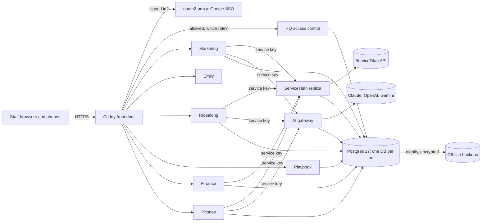

# HGFI Tools: one sign-in, one access model and one design system for a plumbing company's own software

> **Status:** in daily use; every tool runs in production with its own test site, versioned releases and an owner-readable changelog · **Built:** September to October 2026, across 12 private repos · **Stack:** Next.js 16, React 19, TypeScript, PostgreSQL 17, Prisma 7, Caddy, oauth2-proxy, Docker · **Source:** private (closed source)

## The problem

Honey Go Fix It (HGFI) is a plumbing and home-services company in Dayton, Ohio, that I co-founded and run the software and finance for. It ran on rented software and outside services: field-service software, an outsourced marketing agency, a commercial email platform, a third-party coaching SaaS and a paid SOP/training platform. Each had its own login, its own copy of our customers and rules we could not change. When the company moved its field-service platform from Housecall Pro to ServiceTitan at the end of September 2026, I built our own layer around it instead of renting more.

## What I built

HGFI Tools is a self-hosted platform of about ten web apps, three Android apps and the shared infrastructure under them. Every tool sits behind one Google sign-in and one access-control service, uses one design system and keeps its data in its own database. Each replaces a paid product or an outsourced function, and every business choice in it is a setting on a screen with history, not a code change.

- **HQ**: the command center: tool tiles, a cross-tool "needs attention" feed and central role-based access.
- **[ServiceTitan connection service](02-servicetitan-replica.md)**: a read-only replica of 135 ServiceTitan sources plus a guarded write layer.
- **[Finance](03-finance-job-costing.md)**: job costing across QuickBooks Online, Ramp and Plaid, with Claude reading the receipts.
- **[Phone system](06-phone-system.md)**: call routing, softphone and recordings on Telnyx, plus a native Android app.
- **[Emily](07-emily-ai-assistant.md)**: an AI after-hours assistant that answers and books customers.
- **[AI gateway](08-ai-gateway.md)**: one call shape for Claude, OpenAI, Gemini and OpenRouter, with a cost ledger.
- **[Ridealong](09-ridealong.md)**: in-home visit recording, transcription and AI coaching scores.
- **[Marketing](10-marketing-platform.md)**: leads, email on Amazon SES, texting, SEO and online booking.
- **[Playbook](11-playbook.md)**: versioned policies and SOPs with sign-offs and quizzes.
- **[Analyst kit](05-analyst-kit.md)**: plain-English, read-only reporting through Claude Code.

## Architecture

- **One server, private network.** One DigitalOcean droplet (4 vCPU, 8 GB) runs Docker Compose. Each tool is a container that publishes no port, with dev and production instances on separate databases.
- **Front door.** Caddy 2 serves about 15 sites with automatic HTTPS and security headers, and redacts token-bearing webhook paths from its access log.
- **Identity, then authorization.** oauth2-proxy answers "is this a signed-in company account?" with one cookie across every tool; HQ answers "may this person open this tool, and in what role?" The ServiceTitan replica and AI gateway have no public address and take per-service keys.
- **Data.** One Postgres 17 container, one database per tool, Prisma 7 and hand-checked SQL migrations applied at container start; media in object storage behind short-lived signed URLs.
- **One app convention.** Next.js 16, React 19, TypeScript and Zod 4 in standalone Docker images, styled by the shared "Honeycomb" design system (one CSS file and a Shell component, master copy in HQ).

## Engineering highlights

- **Two chained checks at the proxy.** Caddy calls oauth2-proxy and then HQ as two `forward_auth` steps and copies identity only from their answers, so a client cannot spoof it. I documented the trap on the way: Caddy runs `request_header` after `forward_auth`, so a naive header-stripping line deletes the real identity too.
- **Fail closed, with break-glass.** HQ's decision is a pure function with its own tests. A database fault denies everyone except the owner account, which bypasses HQ at the proxy and inside HQ, so an HQ bug can neither lock the owner out nor let anyone else in. One registry drives tiles, admin roles and proxy checks, so they cannot drift.
- **Machines get their own door.** `/api/internal/*` returns 404 from outside. Android apps and scripts use prefixed bearer tokens that pass the browser gate with identity headers stripped, and apps never trust identity headers on a token request.
- **A deploy never blanks a secret.** On every deploy a server-side script merges the new environment file with the running one, treats Compose's "empty" values (spaces, a lone carriage return, `""`) as missing, keeps five rotating copies and refuses to start a tool without its required keys. It prints key names only, and tests cover it.
- **Guarded deploys without a CI server.** Deploy scripts run type-check, lint, format and tests, refuse a checkout behind `origin/main` and take a server-wide lock. Production deploys require typing "production" and are refused from non-owner sessions.
- **Backups you can rebuild from.** Nightly, every database, data volume and server-side secret is dumped, encrypted with GPG (AES-256) and copied off-site, backed by a written rebuild-from-nothing runbook.
- **Settings with history.** Ring flows, coaching scorecards, the AI model per job, matching thresholds and email schedules are versioned records with restore; ring flows are validated on save for loops and the longest caller wait.

## Details

| Detail | Value |
|---|---|
| Web apps / Android apps | about 10 / 3 |
| Screens to onboard or offboard a person everywhere | 1 |

## Tech stack

- **Built with:** TypeScript, SQL, Kotlin, Java, Bash, Python
- **Frameworks:** Next.js 16 (App Router), React 19, Zod 4, Jetpack Compose
- **Data:** PostgreSQL 17, Prisma 7 (`pg` adapter), DigitalOcean Spaces (S3 API)
- **Integrations:** Google Workspace, ServiceTitan, Housecall Pro, QuickBooks Online, Ramp, Plaid, Telnyx, Deepgram, Amazon SES, Firebase, Anthropic Claude, OpenAI, Gemini
- **Infra:** DigitalOcean, Docker Compose, Caddy 2, oauth2-proxy, GPG + rclone, Bitwarden Secrets Manager, Tailscale
- **Testing:** Vitest, Node test runner, JUnit, shell assertion suites, end-to-end tests that place real calls through Telnyx

## How it was built

I designed the architecture and the security model, wrote the specs and business rules, set the acceptance tests and own every production deploy; the code was written with Claude Code, often several agent sessions in parallel working from one written spec. Every repo carries an `AGENTS.md`/`CLAUDE.md` and a `docs/HANDOFF.md`, so any agent or person can pick up a tool cold.

## What I'd do next

- Move Finance's receipt reader and Emily onto the AI gateway, so every AI call lands in one cost ledger.
- Add CI so checks run on every push, not only at deploy time.
- Promote the pilots to production instances and run a timed restore drill from the off-site backups.
