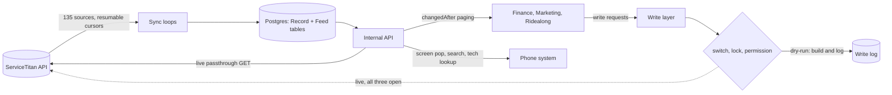

# ServiceTitan connection service: one synced replica and one guarded write door for every internal tool

> **Status:** running against the live ServiceTitan tenant since September 24, 2026; bookings, booking cards and call notes write live since October 17; every test site writes to a separate sandbox tenant · **Built:** September to October 2026 · **Stack:** TypeScript, Next.js 16 route handlers, PostgreSQL 17 (JSONB), Prisma 7, Zod 4, Vitest, Docker · **Source:** private (closed source)

## The problem

Honey Go Fix It (HGFI), a plumbing and home-services company in Dayton, Ohio, that I co-founded and run the software and finance for, moved its field-service platform to ServiceTitan on September 30, 2026. Four internal tools needed its data: Finance, Marketing, Ridealong and the phone system. If each held its own token, they would fight over one rate budget, duplicate the sync logic and each become a separate way to write into the system that runs the business.

## What I built

An internal service with no user interface and no public address. It keeps a continuously synced, read-only copy of the company's ServiceTitan tenant in Postgres and serves it to the other tools through an internal API. The writes other tools need (the AI assistant's bookings, Finance's job costs) go through one audited door that is dry-run by default.

- Sync of 135 ServiceTitan sources (53 export feeds and about 80 settings lists) across 23 API areas, on 2, 30 and 60-minute cadences
- Change polling with a stable cursor, plus a live passthrough for anything not replicated
- Caller screen-pop, customer search and "is my technician on the way" lookups for the phone system
- A write layer for three kinds of write (bookings, receipt attachments on jobs, job purchase orders), each with its own switch

## Architecture

- **Source catalog from the vendor's OpenAPI specs.** Generated from ServiceTitan's 25 official specs (about 680 endpoints); each source is an `export` (resumable cursor), a `list` (incremental by modified date) or a `single`.
- **Generic storage.** One `Record` table keyed by entity and id holds the full JSON, `modifiedOn` and a `syncedAt` that moves only when the content actually changed, so consumers can poll for real changes. A `Feed` table tracks each source's cursor, counts, last error and whether our plan includes it.
- **Internal API.** Route handlers for records, live passthrough, lookups, search, writes, the write log, status and settings. Callers need a service key, and the proxy never routes these paths from outside.
- **One token.** OAuth client-credentials tokens last 15 minutes and are refreshed under a database row lock, so concurrent processes never race to refresh.

## Engineering highlights

- **A replica in front of a rate-limited SaaS API.** One token and one rate budget serve every tool, tools keep working when the vendor is slow, and sources outside our plan are detected and marked, not retried forever.
- **Three independent gates before any live write.** A kind is sent only when its switch says `live` (a setting with history that only an admin key inside the container can change), a server-only live-writes lock is open (no deploy script writes it), and the vendor permission is present in the token. All three are re-checked before every request, and a caller can ask for less than a switch allows, never more.
- **Dry-run that shows its work.** In dry-run the service validates every id against the copy, re-reads what must be live, builds the exact ServiceTitan requests and stores them in the write log. The owner reviews days of "would have sent" before a kind goes live.
- **Exactly-once without vendor support.** Idempotency keys are tied to the request body, and a live write claims its key before sending, so two concurrent requests cannot both send. Marks written into ServiceTitan itself (a call id on the job, a short charge id in the receipt file name, a charge prefix on the purchase-order memo) let a retry after a partial failure find and reuse what already exists, even if ServiceTitan renames the upload.
- **Business rules checked against live data.** A booking re-reads the live arrival window and counts visits over the whole business window, including visits still in the legacy system, against capacity; counting only the arrival window would miss the earlier visits in a window already under way. Do-Not-Service customers and disallowed job types are refused, and each kind has daily and per-minute caps. Purchase orders stay refused until the accounting sync settings rule out booking a card charge twice.
- **Millisecond phone lookup over JSONB.** Normalized phone indexes and SQL functions live in a raw SQL migration because Prisma cannot express them. On the server, 86 numbers sent in four formats all matched exactly, checked against counts from an independent full scan that did not use the lookup's indexes. A test keeps the SQL and TypeScript phone normalizers in lockstep against a real Postgres.
- **Vendor quirks written down.** An export endpoint that fails on the vendor's side, Cloudflare rejecting requests without a named user agent, and endpoints that return bare arrays are documented and handled.

## Details

| Detail | Value |
|---|---|
| ServiceTitan sources replicated | 135 (53 export feeds, about 80 settings lists) |
| Phone lookup, server time | p50 about 31 ms |

## Tech stack

- **Built with:** TypeScript, SQL, JavaScript (server CLI), Bash
- **Frameworks:** Next.js 16 route handlers (API only), Zod 4
- **Data:** PostgreSQL 17 with JSONB, custom indexes and SQL functions, Prisma 7 (`pg` adapter, 6 models)
- **Integrations:** ServiceTitan REST APIs (accounting, CRM, dispatch, job management, inventory, payroll, pricebook, memberships, marketing, telecom, timesheets, forms, settings)
- **Infra:** Docker on a private network with no public address; the deploy script runs type-check, lint and tests
- **Testing:** Vitest with fakes, a scratch-Postgres suite, and on-server latency and correctness proofs

## How it was built

I wrote the spec, set the business rules (what a booking must check, when a purchase order is safe) and defined the go-live procedure: review a kind's dry-runs, grant one permission, create one labeled test record, then open the lock for that kind only. Claude Code wrote most of the code against the spec and its tests; each lookup release is proven on the server with sample numbers chosen inside the database and never printed.

## What I'd do next

- Turn on writes one kind at a time, each after a review of its dry-runs.
- Route call notes and bookings for new callers through the same write layer, dry-run first.
