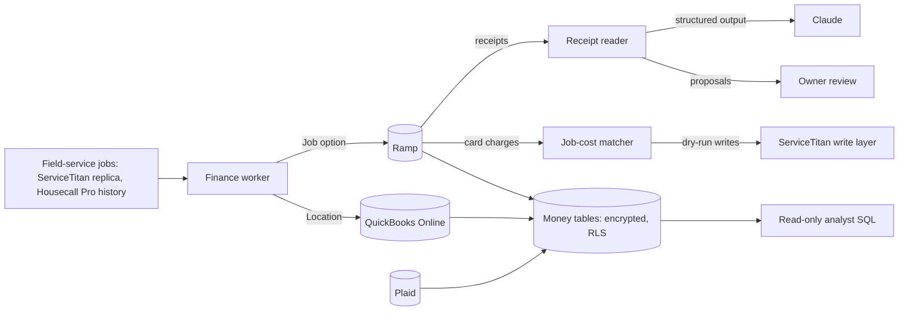

# Finance: job costing across QuickBooks Online, Ramp and Plaid, with Claude reading the receipts

> **Status:** Internal; the dev instance runs against the company's real QuickBooks Online, Ramp and field-service data; ServiceTitan job-cost writes are dry-run only · **Built:** September to October 2026 · **Stack:** Next.js 16, TypeScript, PostgreSQL (row-level security), Prisma 7, Anthropic Claude (structured outputs), QuickBooks Online API, Ramp API, Plaid · **Source:** private (closed source)

## The problem

Honey Go Fix It (HGFI) is a plumbing and home-services company in Dayton, Ohio, that I co-founded and run the software and finance for. The owners wanted true job costing: what each job actually cost in material. Card spend lived in Ramp, the books in QuickBooks Online and the jobs in field-service software, and nothing tied them together. The usual fix asks technicians to do bookkeeping, which does not happen at a supply-house counter.

## What I built

An owners-only tool that turns every field-service job into a cost-tracking dimension. Within seconds of a job being created, it appears as a choice in Ramp's custom "Job" field and as a QuickBooks Online Location, so a technician can tag a purchase at the counter and "P&L by Location" becomes the job P&L. Claude reads each receipt and proposes the QuickBooks category and job, splitting mixed receipts with tax spread to the cent. After the switch to ServiceTitan, card charges are matched to the job they belong to and queued for ServiceTitan's write layer.

- Live job list synced from the field-service platform, with manual add
- Receipts: Claude proposals with apply and split
- Job costs: a "needs you" queue, per-job dry-run results and "ask again"
- Money: bank and card activity from Plaid, Ramp and QuickBooks in clean SQL tables for read-only reporting
- Banks: Plaid Link and unlink; Settings: every business choice, each with change history

## Architecture

- **In-process worker loops.** New jobs every 20 seconds become a Ramp Job option and a QuickBooks Location; tagged Ramp purchases every 5 minutes get the Location on the synced QuickBooks purchase; receipts every 10 minutes go to Claude; ServiceTitan jobs every 2 minutes from the internal replica; job-cost matching every 5 minutes. A separate money loop keeps its last-run times in the database, so restarts resume.
- **One QuickBooks token.** It lives in the tool's database and is refreshed under a row lock so several processes never race. A command-line client (query, get, report, update, create, batch, and deliberately no delete) runs inside the container and borrows the token over localhost.
- **No direct ServiceTitan calls.** Finance posts job costs to the [ServiceTitan connection service](02-servicetitan-replica.md)'s guarded write endpoint and stores each answer per charge.
- **Money tables.** Accounts, daily balances, transactions, card users, QuickBooks accounts and report lines are upserted on source-prefixed ids, so re-runs never duplicate; QuickBooks reports are flattened into rows by section and depth.

## Engineering highlights

- **An evidence ladder for matching charges to jobs.** The matcher ranks evidence with confidence scores: the technician's pick in Ramp, then the owner's pick, then a job number read from the receipt or memo cross-checked against the cardholder's scheduled visits, then a schedule-based guess within a time window. Guesses are never sent without a human, and the thresholds are settings with history.
- **Idempotent "ask again".** Each charge is re-sent only when its inputs or the write layer's state change, tracked by a stored state fingerprint. Split charges are handled per part, each with its own idempotency key.
- **Receipt reading with a short leash.** Claude returns Zod-validated structured output (category, job number, line items, split proposal). The reader is suggest-only by default; an optional auto mode is limited to simple single-category, high-confidence receipts.
- **Bank data encrypted at rest.** AES-256-GCM with a random 96-bit IV and a versioned format for key rotation; only the fields needed for lookups stay readable. Plaid tokens are sealed, and a retention job purges data past seven years.
- **Row-level security for reporting.** Postgres RLS lets the read-only analyst role see only accounts an owner has marked as business.
- **A written security program.** Five documents for the bank-data integration (information security, access control, data retention, vulnerability management and an access review log), plus `npm audit` and a Trivy image scan on every deploy; the runtime image ships without npm.
- **Polite to rate limits.** Statement downloads pace themselves and resume, and only one sync per bank login runs at a time.

## Details

| Detail | Value |
|---|---|
| New job to Ramp option and QuickBooks Location | about 20 seconds |
| Background worker loops | 6 |

## Tech stack

- **Built with:** TypeScript, SQL, JavaScript (CLI scripts), Bash
- **Frameworks:** Next.js 16, React 19, Zod 4, Anthropic TypeScript SDK with structured outputs
- **Data:** PostgreSQL with row-level security, Prisma 7 (`pg` adapter), Node `crypto` (AES-256-GCM)
- **Integrations:** QuickBooks Online API (OAuth 2.0), Ramp API (client credentials), Plaid (Link, transactions sync, balances, statements, webhooks), Anthropic Claude, Housecall Pro API (read-only history), ServiceTitan via the internal replica and write layer
- **Infra:** Docker on the shared server, Google SSO plus the HQ "owner" role, Trivy, `npm audit`
- **Testing:** Node test runner; dry-run mode for every outbound write

## How it was built

I set the accounting design (Location as the job dimension, Class left free for ServiceTitan's business units, and standing STOCK and SHOP choices for purchases that belong to no job), the matching rules and the security policies; Claude Code wrote most of the code from those specs. I run it against the real books as the company's bookkeeper, which is how its rules got tested.

## What I'd do next

- Launch the production instance and turn on ServiceTitan job-cost writes after a review of their dry-runs.
- Route the receipt reader through the suite's [AI gateway](08-ai-gateway.md) so its cost lands in the shared ledger.
