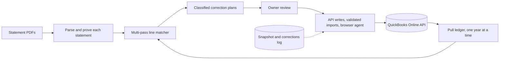

# Books rebuild: a reconciliation toolkit that ties every account to its statements, line by line

> **Status:** Internal and ongoing; the history is reconciled and the current phase is the 2026 catch-up after the field-service platform switch · **Built:** August–September 2026, 22 Python scripts (a working toolkit, not a repository) · **Stack:** Python, pandas, pdfplumber, openpyxl, QuickBooks Online API, Playwright, Claude Code · **Source:** private (closed source)

## The problem

Honey Go Fix It (HGFI) is a plumbing and home-services company in Dayton, Ohio, that I co-founded and run the software and finance for, and I am its bookkeeper. Like many small businesses, its QuickBooks Online file had been kept by bank-feed matching since the company opened in 2022, not by statement-by-statement reconciliation. Before the books could support decisions or the move to a new field-service platform, every bank and card account had to tie to its statements, every line explained.

## What I built

A Python forensics toolkit and a QuickBooks Online API workflow that rebuilt the books from the company's first year onward. It parses years of statement PDFs into ledgers that are proven complete, reconciles them against the QuickBooks general ledger transaction by transaction, and produces correction plans, with QuickBooks ids and links, that I or a browser agent then execute. It also rebuilds schedules (depreciation, lease amortization, clearing accounts) as journal-entry imports.

- Statement parsing with a completeness proof for every statement
- General-ledger pulls through the API, one year at a time to stay under report limits
- Multi-pass, line-level matching with ambiguity reported, never guessed
- Classified correction plans: JSON for an agent driving the QuickBooks UI, Markdown for human review
- An immutable snapshot before any change and a one-line-per-change corrections log

## Architecture

- **Parse.** Statement PDFs become signed transaction ledgers. A statement is used only after beginning balance plus activity equals ending balance.
- **Pull.** The general ledger and entities come from the QuickBooks API; sliced register exports are stitched together and proven by their running-balance column.
- **Match.** Several passes, tolerant on date and exact on amount, each validated in aggregate. A billing-cycle boundary map (posting date against transaction date) explains why a period would not close.
- **Plan and correct.** Delete lists are classified (duplicate, canceling pair and so on), never a raw "unmatched" list. Writes go through the API or through journal-entry import files validated locally first.
- **Execute what has no API.** Playwright over the Chrome DevTools Protocol drives web screens that have no API, such as statement downloads and reconcile screens.

## Engineering highlights

- **Financial data has no primary key.** Matching accepts only unique matches and reports ambiguity instead of guessing. For example, a combined payroll remittance is matched to the payroll date whose accrued liability equals it, not to the nearest similar amount.
- **Subset-sum is a trap.** The deposit workbench proposes which payments make up a deposit only when the answer is unique or uses the whole candidate pool. It learned this the hard way: one pool had billions of valid subsets.
- **Silent parse failures look like findings.** Every bucketed report must reconcile to its source total to the cent before it is reported. That rule caught a pandas 3.0 behavior change, where `astype(str)` keeps NaN, that had silently dropped rows.
- **PDF parsing that respects the document.** The parser uses the issuer's hidden section markers and handles wrapped lines and reordered columns, using positional text extraction so page order is preserved.
- **Corrections you can undo.** An immutable full-ledger snapshot is taken before any change; the QuickBooks CLI has no delete command; the rule is void over delete; and nothing is removed because money "can't be found", only confirmed duplicates and canceling pairs.
- **Schedules from first principles.** A depreciation engine computes its rates from the method itself and self-tests against the published reference tables; lease prepayments amortize from the commencement date.
- **An AI audit at scale.** A full-history categorization sweep ran as parallel "finder" agents plus adversarial "verifier" agents, then was synthesized into worklists: 378 findings raised, 135 verified.
- **API lessons kept as rules.** QuickBooks updates must send the full object; the journal-entry importer reports only the first class of error, so files are checked locally against every rule first; and a register export can be silently truncated while still showing the true ending balance.

## By the numbers

| Metric | Value |
|---|---|
| Core toolkit | 22 Python scripts, ~3,900 lines |
| Monthly statements of the main operating account reconciled to a zero difference | 40 of 40 |
| Credit and charge cards tied to their statements | all, across three fiscal years |
| Categorization findings | 378 raised, 135 verified |
| Delete commands in the QuickBooks CLI | 0 |

## Tech stack

- **Languages:** Python, Bash
- **Libraries:** pandas, pdfplumber, openpyxl
- **Data:** CSV and JSON ledgers, immutable snapshots, a corrections log
- **Integrations:** QuickBooks Online Accounting API (queries, reports, full-object updates, batch) through a CLI that borrows the [Finance tool](03-finance-job-costing.md)'s OAuth token; spend-management and field-service APIs for source data; Google Drive for the archive copy
- **Infra:** Playwright over the Chrome DevTools Protocol; Claude Code multi-agent workflows
- **Testing:** statement completeness proofs, control totals on every report, self-tests against reference tables

## How it was built

I built the toolkit in August and September 2026 while doing the bookkeeping myself. I set every accounting rule, decided every case the data could not decide and approved every correction. Claude Code wrote and ran most of the scripts, parallel agent sessions ran the categorization sweep, and a browser agent carried out UI-only steps from the JSON hand-off bundles.

## What I'd do next

- Turn the monthly reconciliation into a scheduled job inside the [Finance tool](03-finance-job-costing.md), using its bank feeds instead of PDFs.
- Package the matcher and the statement proofs as a reusable library for other small-business books.
