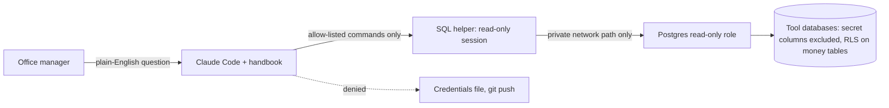

# Analyst kit: safe, read-only production data access for a non-programmer, through Claude Code

> **Status:** In use by the office manager since October 2026 · **Built:** October 2026, 5 commits · **Stack:** Claude Code, PostgreSQL 17, psql, SQL, Bash, Tailscale · **Source:** private (closed source)

## The problem

Honey Go Fix It (HGFI) is a plumbing and home-services company in Dayton, Ohio, that I co-founded and run the software and finance for. Our office manager is not a programmer, but she needed answers that live across the suite's databases: which channels turn into completed jobs, how card spend breaks down by category, how a campaign did. Building a dashboard for every question is slow. Giving an LLM agent production credentials is risky: it could change data, print a secret, send customer data somewhere it should not go, or report a confidently wrong number.

## What I built

A kit, installed on her Linux laptop by one idempotent setup script, that lets her ask business questions in plain English while Claude Code writes and runs the SQL. It contains a SQL helper, a data map of every tool database, 15 tested example reports and a `CLAUDE.md` handbook that tells Claude Code exactly how to behave. Each answer leads with the result, then the table, then the SQL, and names the database, the era, the date range and the units.

- Run a ready-made report or ad-hoc read-only SQL against any tool database
- CSV export into a folder that git ignores
- A data map in plain words, with a column appendix generated from the live catalog
- Example reports on jobs, leads, calls, email campaigns, marketing spend, card spend by category and vendor, cash in and out, and P&L by month

## Architecture

The safety model is six independent layers, so no single mistake exposes anything:

- **Network.** The reporting role is reachable only over a private Tailscale path, and Postgres's host rules are pinned to that path.
- **Server role.** The role has SELECT only. A re-runnable script computes per-column grants from the live catalog and excludes every table or column that holds a key, token, sign-in or webhook secret (13 exclusion rules across 8 tool database families). A database it does not recognize is skipped until its tables have been checked. The role also carries query-time and connection limits.
- **Rows.** In the [Finance tool](03-finance-job-costing.md), Postgres row-level security shows this role only the accounts an owner has marked as business.
- **Client session.** The helper forces `default_transaction_read_only=on` on every connection, a second lock behind the server's role.
- **Agent permissions.** The project's Claude Code settings allow only the SQL helpers and read-only git commands, and deny reading the credentials file and `git push`.
- **Behavior.** The handbook's rules: read only; never contact customers or post anything; never print secrets; customer data stays on the laptop and shared results are totals and trends, not lists; ask the owner before anything that changes data.

## Engineering highlights

- **Defense in depth for an LLM with production access.** Each layer above would hold on its own. The handbook asks for good behavior; the role, the session and the permission deny-list enforce it whether or not the model complies.
- **A data map that encodes the traps.** It records which databases store money in cents and which in dollars, which fields are UTC timestamps and which are date-only, the cut-over date between the two field-service systems (and why per-technician history must come from the older system's copy), and Prisma's quoted identifiers. These are the mistakes that produce wrong answers, not errors.
- **Columns documented from the source of truth.** A helper regenerates the readable-columns appendix from the live catalog, so the map always matches what the role can actually read. A "permission denied" is documented as "you touched something left out on purpose".
- **Examples as guardrails.** Each of the 15 reports declares its database in a header comment that the helper reads, so the agent starts from a tested query instead of guessing joins.
- **Answers that say what they measure.** The handbook requires the era (which field-service system), the date range and the units in every answer, a note when a month is not finished, and a second check of any surprising number.
- **Secret-safe setup.** One idempotent command installs everything. The database password arrives once through an encrypted send and is never printed, and the GitHub host key is pinned rather than trusted on first use.

## By the numbers

| Metric | Value |
|---|---|
| Tool databases readable | 9 |
| Example reports | 15 (~340 lines of SQL) |
| Exclusion rules for secret-bearing tables and columns | 13 |
| Independent safety layers | 6 |
| Setup | 1 command, safe to re-run |
| Build time | 3 days (Oct 4 to 6, 2026), 5 commits |

## Tech stack

- **Languages:** SQL, Bash, Markdown (the handbook is the agent's operating manual)
- **Frameworks:** Claude Code with a project `settings.json` permission allow-list and deny-list
- **Data:** PostgreSQL 17 read-only role, column-level grants, row-level security, psql
- **Integrations:** the suite's tool databases, GitHub (deploy-key pull for updates)
- **Infra:** Tailscale, Arch Linux, the shared Postgres server
- **Testing:** the example reports are tested queries; setup finishes by running a test query over the private path

## How it was built

I built it between October 4 and 6, 2026. I designed the safety model, decided what the role may and may not see, and wrote the handbook's rules; Claude Code wrote the scripts and the data map, and the column appendix is generated. The interesting part is that the product is a prompt, a permission file and a set of database grants engineered together, with each one assuming the others might fail.

## What I'd do next

- Log every query the agent runs and review the log weekly.
- Turn the most-asked questions into saved views in the tools themselves.
