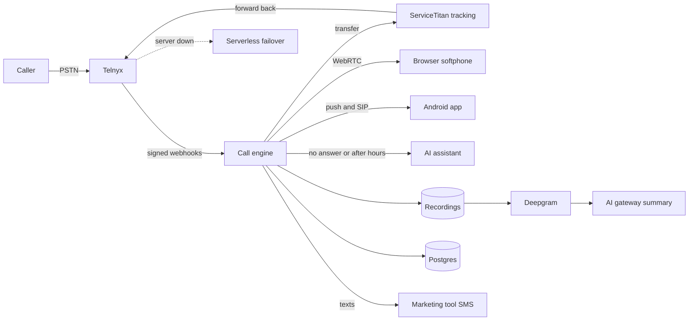

# HGFI Phones: a company phone system on Telnyx, with its own Android calling app

> **Status:** pilot on staging, proven on real calls; Android app sideloaded to staff · **Built:** October 2026, 127 commits (94 server + 33 app) · **Stack:** TypeScript, Next.js 16, PostgreSQL + Prisma, Telnyx Call Control and WebRTC, Kotlin, Jetpack Compose, Android Telecom, Firebase Cloud Messaging · **Source:** private (closed source)

## The problem

Honey Go Fix It (HGFI), the plumbing and home-services company in Dayton, Ohio that I co-founded, has just moved from Housecall Pro to ServiceTitan, and the old platform's phone features went with it. ServiceTitan's API cannot create call records, so every call has to "double forward": our number, then ServiceTitan's tracking number, then back to us. Rather than buy another call-tracking product, I built our own phone system.

## What I built

**Part 1** is the phone system: a webhook-driven call engine on Telnyx Call Control with a browser softphone, recordings, voicemail, call-backs, texting and reports. **Part 2** is HGFI Phone, a native Kotlin app that makes company calls ring on Android like ordinary calls, even locked, asleep or on a bad network.

- **Call flows as data:** per-number hours, ring groups, ring steps, an AI assistant step and voicemail, checked on save for routing loops and the longest possible caller wait.
- **Browser phone:** answer, hold with music, keypad, transfer, outbound with company caller ID, call reasons, notes and texts.
- **Caller context:** the ServiceTitan customer card on every ring, plus a "press 1 to reach your technician" menu.
- **After the call:** recordings, Deepgram transcripts, AI summaries, call-back tasks, missed-call texts, and reports by person, hour, number and outcome.
- **Android app:** an Available switch, call-backs, voicemail, recordings, texts, and warm transfers from the AI assistant.

## Architecture

- **Call engine:** every Telnyx event is verified, stored and acknowledged at once, then handled one call at a time through a per-call queue. Timers are timestamps on the call row polled every second, so a restart only delays them; routing decisions are pure functions.
- **One conference per answered call:** callers wait in a not-yet-started conference; the first answer joins it, which stops the other rings and starts the recording at the same instant.
- **Android app:** a pure-Kotlin `core` package (call state machine, outbound and emergency rules, PKCE sign-in) with no Android dependencies, a process-wide call engine (calls arrive with no screen open), and Android's core-telecom for the lock screen, Bluetooth and car. It uses a frozen, versioned API contract.
- **Failover:** a serverless function set as Telnyx's failover URL forwards customer calls to a backup line if the server is down. Written and tested, not yet deployed. Texts go through the marketing tool, the single door for SMS consent.

## Engineering highlights

### Phone system

- **Answer latency cut from about 4.3 s to about 1.8 s:** legs answered in parallel, the caller joined as soon as Telnyx accepts the answer instead of waiting for its webhook, and batched reads so the ServiceTitan hop leaves after about 3 database round trips instead of 14.
- **Latency forensics across three clocks:** I rebuilt call timelines from Telnyx, server and phone logs, found phone clocks drift by up to 2 s, and anchored on the phone's own hang-ups to attribute each delay. A silent push now wakes the app during the ServiceTitan round trip, so the real ring arrives over an open connection.
- **Security on every edge:** Ed25519 verification of every Telnyx webhook with a replay window, one-use tickets for outbound calls (no ticket, no call), emergency calls on their own path, and a block list checked before anything rings.
- **A tested safety net:** if a caller is not connected within a set time after an answer, the answerer hears a message, the caller moves on and the owner is emailed. A fault-injection switch on staging proves it.

### Android app

- **Ringing that actually rings:** the SDK left Android's audio mode in-communication after a call, turning later rings into a soft beep, so the app plays its own ringtone and resets audio. I also fixed an Android 16 freeze before the call service started.
- **Calls that survive bad networks:** relay-first media (TURN over UDP, TCP and TLS), ICE candidates gathered while ringing (0.4 to 1.0 s faster answers), one ICE restart if no audio arrives 1.5 s after answer, all tuned from server settings.
- **A "go-ahead" tone:** a quiet beep the moment the caller can hear the answerer, from a server long-poll plus observed packet flow, with the mic muted while it plays, so staff don't greet into dead air.
- **Updates and diagnostics:** self-installing updates keep the full-screen call permission that Android 14+ resets on browser installs; per-call media diagnostics upload without audio, tokens, names or full numbers.

## By the numbers

| Metric | Phone system | Android app |
|---|---|---|
| Commits | 94 in 8 days | 33 in 3 days |
| Code | ~21,650 TS, ~9,450 TSX, ~4,080 JS | ~8,200 Kotlin + ~750 test lines |
| Data model | 28 Prisma models | server-backed |
| Surface / releases | 67 API routes, 23 pages | versions 0.1.0 to 0.1.15 |
| Tests | ~240 Vitest cases + real-call end-to-end suite | 78 JUnit tests |

The app bundles Telnyx's MIT-licensed `telnyx_common` helper module (~2,800 lines, copied at SDK 3.7.3 with three marked changes). It is Telnyx's code and is excluded from the counts above.

## Tech stack

- **Languages:** TypeScript, Kotlin, SQL, JavaScript
- **Frameworks:** Next.js 16, React 19, Zod 4, Jetpack Compose + Material 3, Jetpack core-telecom, coroutines
- **Data:** PostgreSQL with Prisma 7; recordings in DigitalOcean Spaces behind short-lived signed URLs
- **Integrations:** Telnyx Call Control, WebRTC, SIP and messaging; Telnyx Android Voice SDK; ServiceTitan; Deepgram nova-3; Firebase Cloud Messaging (JWT signed in code, no SDK)
- **Infra:** Docker Compose on DigitalOcean behind Caddy; DigitalOcean Functions for failover
- **Testing:** Vitest with fake database and fake Telnyx; end-to-end tests that place real calls with headless browsers as phones; JUnit

## How it was built

The server took eight days and the app three. I designed the call flows, routing and safety rules and the app contract, wrote the acceptance tests, field-tested on real phones, and read the call timelines that found each delay. Claude Code agents wrote most of the code under that direction. The deploy script runs every test first.

## What I'd do next

- Go live on the existing numbers, then port them to Telnyx.
- Deploy the failover and move field technicians onto the app.
