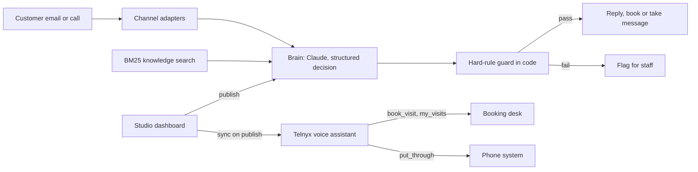

# Emily: an AI front-office assistant with its guardrails in code

> **Status:** live on the company's front-desk line and on overflow from the office phones; office dashboard in production since October 14, 2026 · **Built:** September to October 2026 · **Stack:** TypeScript, Next.js 16, React 19, Anthropic Claude, Zod, Telnyx AI Assistants, Gmail API, Three.js · **Source:** private (closed source)

## The problem

At Honey Go Fix It (HGFI), the plumbing and home-services company in Dayton, Ohio that I co-founded, an owner was answering customer calls and email every evening and weekend. An AI assistant could take that over, but only if it could never quote an unapproved price, promise an arrival time or claim to be a person, and only if the office staff, not a developer, controlled what it knows and says.

## What I built

Emily is the company's AI front-office assistant. She answers customer email and calls, books visits inside the schedule's rules, takes messages, recognizes emergencies, and briefs the office every morning. Everything about her is managed from a "Studio" dashboard written for non-technical staff, where every change is a versioned setting with Publish, History and Restore. Text and web chat are designed and paused until a coordinated launch.

- **Email:** her own Gmail mailbox, polled every minute; replies are held for approval unless auto-send is turned on.
- **Phone:** a Telnyx-hosted voice assistant whose instructions, greeting and tools are generated from the Studio settings.
- **Booking and hand-offs:** books through the shared booking desk (ServiceTitan availability) and warm-transfers callers into the company phone app; the person rung can accept or decline, and a decline returns the caller with a message taken.
- **Studio:** personality, knowledge uploads, rules, hours, service area, transfers, a conversations inbox with recordings, and a customer simulator.
- **Emergency alarm app:** a tiny Android app (about 30 KB, no third-party libraries) that rings the on-call person through silent mode and Do Not Disturb.

She has been live on real calls since October 2026. The phone system hands her the calls the office doesn't answer and every call after hours. Warm transfers ring the office manager first, then a co-owner's cell, and she briefs the person in one sentence before connecting; she offers a transfer rather than promising a call back. Her call flow, qualifying questions and closing lines come from the office's own written policies, while the hard rules stay in code. She runs on a Claude model through our own model bridge (case study 08), which cut model cost per call by about 90%.

## Architecture

- **Brain:** provider-agnostic (Claude by default, a mock in tests); returns a Zod-validated decision of replies, flags and actions.
- **Guard:** a plain-code check on every outgoing reply, whichever model wrote it. A failed check sends nothing and flags a person.
- **Knowledge:** uploads are extracted, split into overlapping chunks and searched with BM25; documents marked "always follow" are included within a token budget.
- **Voice sync:** each Publish pushes instructions, greeting and tools to Telnyx; call recordings and transcripts flow back into the inbox.
- **Storage:** a file-backed JSON store on a Docker volume, backed up nightly; no database.

## Engineering highlights

- **Guardrails in code, not only in the prompt.** The guard rejects any price unless the same figure appears in the office's approved facts or a document marked quotable, any arrival-time promise, any claim to be human, list or dash formatting, texts over 480 characters, banned phrases, and more than three messages per turn. The guard file is the one part of the codebase AI agents may not change without my sign-off.
- **Two assistants, not two modes.** A written rule every build follows: the customer-facing Emily and a staff-facing assistant are separate programs with separate credentials, so staff-only tools do not exist in the customer program and no prompt can reach them. Customer text is always data, never instructions; caller ID is never trusted (staff requests by phone get a call back); staff actions are tiered up to "needs a signed-in tap".
- **Golden conversations as a deploy gate.** Twenty example chats run against the real model on a throwaway copy of the app, and any failure blocks the deploy. They cover burst pipes, gas smells and sewage backups as emergencies, never quoting a price even when pushed, refusing and flagging prompt injection, "stop means stop", staying honest about being an AI, and remembering what a customer said on an earlier phone call.
- **BM25 retrieval instead of a vector database.** Stemmed keyword search over overlapping chunks needs no outside service, answers instantly, and lets the office see exactly which passages Emily used for a reply.
- **One set of settings, two runtimes.** The voice assistant runs on Telnyx's platform, but its prompt and tools (`book_visit`, `my_visits`, `put_through`) are generated from the same published settings as the email brain, so the office edits Emily once. A test line can be switched between TeXML and Call Control from the Studio.
- **Policy research turned into product rules.** Under the FCC's February 2024 ruling, an AI voice is an "artificial voice" under the TCPA, so Emily only calls people who agreed to it. SMS consent on calls uses the exact wording of the company's texting campaign filing.

## Details

| Detail | Value |
|---|---|
| Hard rules checked in code on every reply | 7 |
| Golden conversations gating each deploy | 20 |
| Emergency alarm app | about 30 KB, no third-party libraries |

## Tech stack

- **Built with:** TypeScript, TSX, CSS, Java (Android)
- **Frameworks:** Next.js 16, React 19, Zod, Three.js and Motion (an animated bee avatar), mammoth and unpdf (document uploads)
- **Data:** file-backed JSON store with nightly backups; call recordings in DigitalOcean Spaces behind 15-minute signed links
- **Integrations:** Anthropic Claude, Telnyx AI Assistants, Call Control and TeXML, Gmail API with Google OAuth, the suite's booking desk (ServiceTitan) and phone system
- **Infra:** Docker on DigitalOcean behind Caddy, Google Workspace sign-in through the suite gateway
- **Testing:** Node test runner; one pre-deploy script runs types, lint, tests, a production build and the golden conversations

## How it was built

The project runs on written vision, decisions and safety documents, the two-program rule, and golden conversations that define acceptable behavior. I set those rules and acceptance cases; Claude Code agents wrote most of the code against them.

## What I'd do next

- Launch text and web chat together with the rest of the office's channel switch.
- Build the staff-facing assistant as its own program under the two-program rule.
- Add AI-assisted editing in the Studio so staff can describe a change and review it before Publish.
