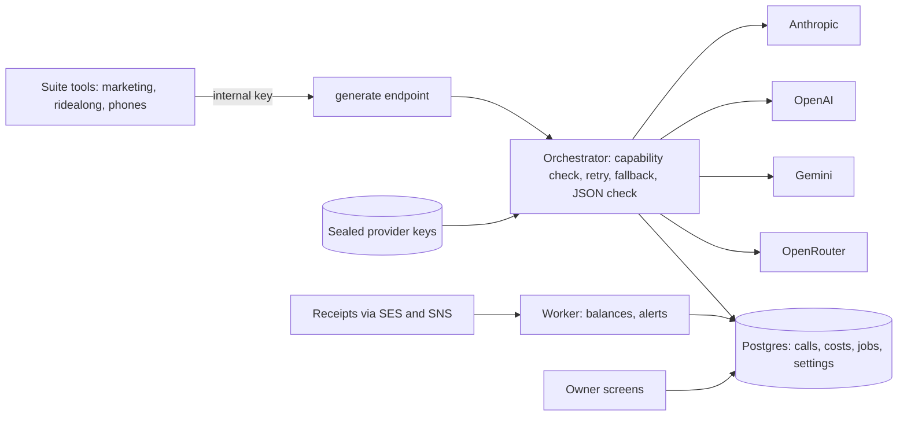

# AI Gateway: one internal API for every LLM job, across four providers

> **Status:** in production since October 14, 2026; serves every tool's AI jobs and is the voice model bridge for the AI receptionist · **Built:** September to October 2026 · **Stack:** TypeScript, Next.js 16, PostgreSQL + Prisma 7, Anthropic / OpenAI / Gemini SDKs, Ajv, Zod, Amazon SES + SNS, Vitest · **Source:** private (closed source)

## The problem

Honey Go Fix It (HGFI), the plumbing and home-services company in Dayton, Ohio that I co-founded, runs on a suite of internal tools I built, and more of them were calling LLMs: drafting marketing emails, scoring recorded visits, summarizing phone calls. Each tool held its own provider keys, hard-coded its model, and nobody could see what a given job cost. Changing a model meant a code change and a deploy, and structured output behaved differently on every provider.

## What I built

A small internal service that every tool calls instead of calling a provider directly. It holds all provider keys sealed in the database, exposes one request shape for every job, lets the owner choose the model for each job on a screen, records the cost of every call, and alerts on spend or low credit. Tools reach it over the private network with a small client file they copy in.

- **One call shape** across Anthropic, OpenAI, Google Gemini and OpenRouter, streaming under the hood.
- **Jobs registry:** each tool registers its jobs; model, effort and time limit per job are versioned settings with history and restore.
- **Orchestrator:** checks model capabilities before spending, retries with backoff, falls back to the next model, and validates JSON output.
- **Cost ledger and alerts:** per-call cost, monthly totals, caps, balance snapshots, credit estimates and staff email alerts.
- **Receipts inbox:** provider billing receipts forwarded by email are read by an AI job (with a pattern-matching fallback) and sorted into API credit versus subscriptions; unclear ones wait for a click.

## Architecture

- **Generate endpoint:** one POST route for every job. Callers name a registered job and may suggest a model or effort, but the owner's job settings win.
- **Provider adapters:** one per provider, sharing an SSE parser and a capability matrix (JSON schema, images, PDFs, web search, effort, long output, prompt caching).
- **Background worker:** balance snapshots, credit estimates, alert rules and staff email.
- **Receipts pipeline:** inbound email arrives through Amazon SES with an SNS webhook, then the AI "receipt reader" job sorts it.
- **Owner screens:** Jobs, Providers (keys and connection tests), Models and prices (with an ability test), Usage, Alerts and Settings, each with history and undo.

## Engineering highlights

- **Structured output that never silently loses data.** Providers quietly rewrite JSON Schemas, and a rewritten schema can drop fields that a validator then happily accepts. A schema-compatibility analyzer walks every subschema and decides per provider whether native mode is safe: Anthropic is avoided for open maps, `patternProperties` and recursive `$ref`; Gemini gets a cleaned copy with ignored keywords moved into descriptions, and is avoided when the schema depends on `const`, `allOf`, `not` or `if`; OpenAI uses `strict` only when every object is closed and fully required. Everything else falls back to prompt mode. Results are cached by schema hash, and every output is re-validated with Ajv regardless.
- **Sealed keys and a scrubber.** Provider keys are encrypted at rest with AES-256-GCM, opened only for a call, and never sent back to a browser (screens show the last four characters). A scrubber replaces every secret the process knows, plus anything shaped like a provider key, in stored errors, logs and responses. The shared internal key rotates with zero downtime because old and new keys are both accepted during rollout.
- **Prompts and answers are never stored.** The ledger keeps metadata and cost only, so the gateway is not a second copy of customer data.
- **Graceful restarts.** On deploy, new calls get a clear "restarting" response while in-flight calls drain up to a limit. I turned off Next.js's own signal handler so the listener stays up during the drain, and any call cut off still closes its ledger row with the usage the stream had reported.
- **Real cost math.** The cost formula picks the right price row for input, output, cache reads, cache writes and web-search units, then rolls up monthly totals against caps.
- **Voice model bridge.** An OpenAI-compatible streaming endpoint that a hosted voice platform calls for each of the AI receptionist's replies, with a backup model behind it. Every turn lands on the same usage and cost ledger as the other jobs. One bug worth knowing about: tool calls with no arguments were sent as an empty string, which the voice platform silently ignored, so the assistant could never hang up. They are now sent as an empty JSON object.
- **Daily model review.** Each morning the saved test cases for each job are re-run on cheaper Claude models, and a job switches by itself only to a cheaper model that scored at least as well.
- **Tests against recorded streams.** Provider adapters are tested by replaying recorded real streaming responses (cache reads and writes, effort levels, images and PDFs, bad keys), not only mocks.

## Details

| Detail | Value |
|---|---|
| Providers | 4 (Anthropic, OpenAI, Gemini, OpenRouter) |

## Tech stack

- **Built with:** TypeScript, SQL
- **Frameworks:** Next.js 16, React 19, Zod, Ajv (JSON Schema validation)
- **Data:** PostgreSQL with Prisma 7 (calls, cost ledger, jobs, settings, alerts, sealed keys)
- **Integrations:** `@anthropic-ai/sdk`, `openai`, `@google/genai`, OpenRouter, Amazon SES and SNS, the suite's Google sign-in gateway and staff mail
- **Infra:** Docker Compose on DigitalOcean behind Caddy, private Docker network between tools
- **Testing:** Vitest with a fake database, route tests, cost tests, schema-compatibility tests and recorded-stream replays

## How it was built

I wrote the spec first: the request contract, per-provider rules, cost formula, security model and restart behavior. Claude Code agents then built the service against it, and the code comments cite spec sections so every behavior traces back to a decision. I own the model choices for each job and the rule that prompts and answers are never stored.

## What I'd do next

- Give production its own instance (one live instance currently serves both the staging and production marketing tool).
- Add per-job quality checks that replay saved examples against a candidate model before switching.
