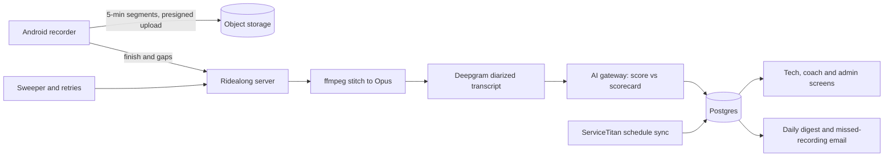

# Ridealong: in-home visit recording and evidence-based AI coaching

> **Status:** in use by the field team on staging after a full-team field test; production site not yet stood up · **Built:** September–October 2026, 42 commits · **Stack:** TypeScript, Next.js 16, PostgreSQL + Prisma 7, Java (Android), ffmpeg, Deepgram nova-3, Anthropic Claude via the suite AI gateway, DigitalOcean Spaces · **Source:** private (closed source)

## The problem

Honey Go Fix It (HGFI), the plumbing and home-services company in Dayton, Ohio that I co-founded, coaches its technicians on how they run each in-home visit. That ran on a third-party coaching SaaS, outside the rest of our systems. Coaching only works if every visit is captured and the feedback is specific: what was said, when, and what to try next. I wanted it in-house, on our own scorecards and job data, with no visit lost to weak signal, a dead battery or an incoming call.

## What I built

Technicians record every in-home visit with an Android app. The server stitches, archives, transcribes with speaker labels, and scores each visit against the company's own editable scorecards. Each tech gets private, coaching-only feedback (strengths before gaps, never tied to pay) and can tap any note to hear the exact moment it refers to. A coach and admins see trends, edit scorecards, and get a daily digest plus a "jobs with no recording" report.

- **Android recorder:** one-tap recording, upload status, today's jobs, "Start recording?" reminders and feedback notifications.
- **Feedback:** per-step notes with timestamped quotes that play back, two specific strengths, one area to work on, and a line to try next time.
- **Disagreement built in:** an "I see this differently" button on any feedback.
- **Scorecards:** an editor with history and restore, rules that pick the scorecard from the job type, and "try it on a visit" before publishing.
- **Oversight:** team trends, roster, missed recordings and a test-week mode; past coaching history imported from the old platform.

## Architecture

- **Android recorder:** plain Java with no third-party libraries. A foreground service writes five-minute segments; a JobScheduler job uploads them straight to object storage through presigned URLs whenever there is signal, never through the web server.
- **Pipeline:** stitch the segments into one Opus archive (kept ten years), transcribe with speaker separation, then make one scoring call. Each step records its status so screens show honest progress.
- **Sweeper:** retries stuck visits, rescues unfinished ones after 12 hours, and waits without spending a retry when the AI service is restarting, busy or out of credit.
- **Schedule sync:** every 10 minutes, ServiceTitan appointments link visits to jobs automatically, so the right scorecard is used.
- **Versioned config:** scorecards, rules, extracted fields, key moments and alerts all publish with history and restore.

## Engineering highlights

- **"Never lose a recording."** Recording is segmented and queued offline; stalled uploads are detected and retried; a phone call that takes the microphone is logged as an explicit gap (and passed to the scorer) instead of stopping the recorder; battery-saver settings trigger a warning. Before anyone reinstalls the app, a "Ready to switch?" check compares the database against the phone's own latest diagnostics report and only says "safe" when a fresh report proves nothing is left only on the phone.
- **Evidence-quoted scoring.** The model returns a validated structure: points per step, a short note, and up to three exact transcript quotes with timestamps, plus exactly two strengths, one improvement and a line to try. It is told never to invent a quote, to say a behavior was absent rather than guess, and to judge what the technician said and did, not the customer's mood or whether the job sold.
- **The company's scorecards, not the model's.** The grading guidance on every step lives in versioned settings the coach edits, not in code, and the rules that choose a scorecard read only a job's number and type, never the customer's name.
- **Honest, idempotent pipeline.** A finished score is never overwritten, and retries reuse words already transcribed, so a failure halfway through costs neither data nor a second transcription.
- **Reminders without exact alarms.** "Start recording?" prompts fire at each scheduled job's start using one inexact alarm, with no exact-alarm permission; the reminder rules have their own unit tests.
- **Trust only the token.** App requests use per-device bearer tokens, and identity headers are never trusted on a token-bearing request.
- **A release guard in the build.** The build script refuses a different signing key, a key change without an explicit flag, or a version code that does not increase.

## By the numbers

| Metric | Value |
|---|---|
| Commits | 42, September 17 to October 1, 2026 |
| Code | ~7,900 TSX, ~4,450 TS, ~4,140 Java |
| Android dependencies | zero third-party libraries (17 Java files) |
| Data model | 14 Prisma models |
| API routes / pages | 32 / 16 |
| Recording segment | 5 minutes |
| Schedule sync | every 10 minutes |
| Audio archive | Opus, kept 10 years |
| Field test | whole field team, 3 days |

## Tech stack

- **Languages:** TypeScript, Java (Android), SQL, Python (one export script for the old platform's history)
- **Frameworks:** Next.js 16, React 19, Zod, Motion; Android SDK with foreground services and JobScheduler
- **Data:** PostgreSQL with Prisma 7; audio in DigitalOcean Spaces via the S3 SDK and presigned URLs
- **Integrations:** Deepgram nova-3 with diarization, the suite AI gateway (Claude by default, model set on a screen), ServiceTitan, Housecall Pro
- **Infra:** Docker Compose on DigitalOcean behind Caddy, ffmpeg on the server, Google Workspace sign-in through the suite gateway
- **Testing:** Android unit tests for the reminder rules; type-check and lint before every deploy

## How it was built

Built over about two weeks in September 2026, with a three-day field test by the whole field team in the middle. I set the coaching rules (evidence for every judgement, strengths first, never tied to pay), the recording-reliability requirements, and the switch-over plan from the old platform, then ran the field test. Claude Code agents wrote most of the code against those requirements.

## What I'd do next

- Stand up the production site and move the team over from staging.
- Keep a set of coach-scored visits as a benchmark, so a model or scorecard change can be checked against human judgement before it ships.
