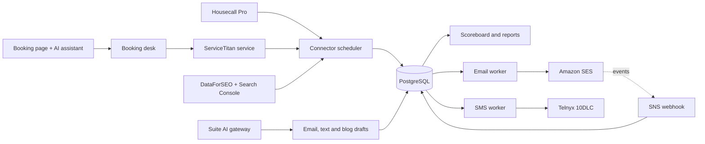

# HGFI Marketing: the company's own email, texting, SEO and booking platform

> **Status:** In production since October 2026 (customer sending behind an owner switch), plus a staging copy · **Built:** September–October 2026, 104 commits · **Stack:** Next.js 16, React 19, TypeScript, Prisma 7, PostgreSQL, Amazon SES, Telnyx, Docker · **Source:** private (closed source)

## The problem

Honey Go Fix It (HGFI) is a plumbing and home-services company in Dayton, Ohio, that I co-founded and run the software and finance for. Its marketing ran through an outsourced marketing agency and Mailchimp, and none of those dashboards could say which leads turned into completed work. In the same weeks, the company was moving from Housecall Pro to ServiceTitan, so every report had to span two field-service systems without counting a job twice.

## What I built

One app in the company's internal tools suite (HGFI Tools) that lets HGFI run its marketing in-house. It judges every lead source and channel by jobs actually completed, sends email through Amazon SES instead of Mailchimp, runs compliant texting on Telnyx, tracks local search rankings, drafts content with AI for a person to approve, and hosts the public booking page. Every business choice (switch date, quiet hours, booking capacity, house style) is a setting on a screen, not a code change.

- **Scoreboard and reports** by lead source, channel, crew and service area, with a lead log, call-backs and a funnel
- **Email:** campaigns with versions and approval, lists, a visual designer, open and click tracking, and a blog queue that turns an approved post into the newsletter
- **Texting:** 10DLC campaigns with a consent ledger; the one door every other company tool sends texts through
- **Search:** keyword and map-grid rank tracking, Search Console data, site checks and a monthly AI fix list
- **Booking desk:** one availability engine shared by the public booking page and the company's AI office assistant
- **Calls, reviews, social and advertising** views, each fed by its own connector

## Architecture

- **Connector framework.** A connector is data (fields, a connection test, a sync function) in a registry, and a scheduler runs them every 5 minutes. Credentials are sealed with AES-GCM, and Google accounts connect through OAuth.
- **Two field-system copies.** Housecall Pro history is copied read-only and incrementally. ServiceTitan is copied every 2 minutes through the suite's internal ServiceTitan service, which also guards every write.
- **Email pipeline.** Amazon SES sends with DKIM, and SNS webhooks feed bounces, complaints, opens and clicks back into the database.
- **Deployment.** A Docker container behind the suite's Google sign-in and role check, with separate staging and production databases. Timers run only on production, and a SIGTERM handler lets in-flight workers finish.

## Engineering highlights

- **Mailchimp replaced in about a week.** Plan on September 30, production sending on October 5, visual designer on October 6. That week covered deliverability (DKIM, a never-mail list that only grows, pacing and warm-up, staggered first sends), event tracking, resend to non-openers, and a one-way import from Mailchimp.
- **Unsubscribe that can't be abused.** Every email carries one-click (RFC 8058) and per-recipient unsubscribe links. An address typed into the unsubscribe page gets an emailed confirmation link instead, rate-limited per network address and per email address, and only that link suppresses. The page answers the same either way, so nobody can unsubscribe someone else or probe the list.
- **Off by default.** Staging can only email staff and Amazon's mailbox simulator. Customer sending stays off until an owner switches it on, an owner kill switch pauses a campaign mid-send, and booking writes run in dry-run mode until enabled.
- **Honest metrics by design.** A job counts as sold only when it is completed, and estimates are traced to jobs through their options. Technicians are judged only on estimates they ran alone, and coaching scores and pay never appear here.
- **A clean cut-over between two field systems.** One switch-date rule decides which system owns each day. It is enforced in both the Prisma query paths and the raw SQL reports, so no job is counted twice. The mapping logic is unit-tested, and every screen is labeled with the system each number comes from.
- **Compliant texting in one place.** 10DLC campaigns come with a consent ledger, STOP and START handling, quiet hours, dry-run mode and automatic go-live when carriers approve a campaign. Every company tool texts through this module, so consent rules live in one place.
- **A booking page that checks twice.** Open windows are computed from ServiceTitan appointments against per-window capacity, then re-checked live just before the booking is written. The page needs no JavaScript, is mobile-first, and has bot checks, per-phone-number limits and idempotent resubmits.
- **Launch by promotion.** Production was launched from the staging copy with a scripted, single-transaction cleanup of test data and verified table counts. Seven AI jobs run through the suite's AI gateway (email and text drafts, review replies, a weekly Google Business note, a monthly SEO fix list, tracking suggestions), and a person approves each campaign before it sends.

## By the numbers

| Metric | Value |
|---|---|
| Commits | 104 (Sep 19 – Oct 11, 2026) |
| Prisma models | 65 |
| SQL migrations | 31 |
| Pages / API routes | 56 / 79 |
| Automated tests | ~410 cases in 45 Vitest files |
| TypeScript and TSX | ~46,000 lines |
| External services connected | 12 |
| Registered AI jobs | 7 |
| Mailchimp to SES, plan to production | about one week |
| ServiceTitan copy interval | 2 minutes |

## Tech stack

- **Languages:** TypeScript, SQL
- **Frameworks:** Next.js 16 (App Router), React 19, Zod 4, Tiptap 3 (email and blog editor), Leaflet (rank map grid), marked and sanitize-html
- **Data:** PostgreSQL, Prisma 7 with the `pg` driver adapter, hand-checked SQL migrations applied on container start
- **Integrations:** Amazon SES and SNS, Telnyx (10DLC SMS, TeXML call tracking), ServiceTitan, Housecall Pro, Google Search Console, Google Business Profile, DataForSEO, Meta, Metricool, CallRail, WhatConverts, Mailchimp (import), Anthropic Claude through the suite AI gateway
- **Infra:** Docker Compose on DigitalOcean behind Caddy, suite-wide Google Workspace sign-in, a Playwright container for a nightly capture of a lead source with no API
- **Testing:** Vitest, ESLint, Prettier, `tsc`; deploy scripts run every check first and refuse to deploy a checkout that is behind GitHub

## How it was built

I built it in about three weeks (September 19 to October 11, 2026), alongside the rest of the HGFI Tools suite. I wrote the plans and the business rules: what counts as a sale, the switch date between field systems, consent and quiet-hour rules, and which switches stay off until an owner turns them on. I set the acceptance tests and shipped with Claude Code agent sessions working from those specs; 102 of the 104 commits are co-authored with Claude.

## What I'd do next

- Turn on live booking writes once the dry-run log matches what the office actually booked.
