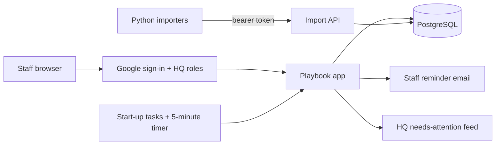

# Playbook: company policies and SOPs, with sign-offs tied to the exact version read

> **Status:** Internal pilot, open to all staff since October 2026; production launch prepared · **Built:** September–October 2026, 13 commits · **Stack:** Next.js 16, React 19, TypeScript, Prisma 7, PostgreSQL, Zod 4, Python, Docker · **Source:** private (closed source)

## The problem

Honey Go Fix It (HGFI) is a plumbing and home-services company in Dayton, Ohio, that I co-founded and run the software and finance for. Its policies, SOPs, forms and training lived in a paid SOP/training platform, separate from the company's other tools and sign-in. Owners needed to know who had read the *current* version of a policy, not just who once clicked "read". A content review also found contradictions between documents and quizzes with wrong answer keys, and there was no structured way to settle them.

## What I built

A knowledge base and compliance tool inside the company's internal tools suite (HGFI Tools). All staff read here; office staff and owners edit. Every edit creates a new page version, each sign-off is recorded against the exact version read, and a real edit asks for fresh signatures. Owners assign documents to a role, department or person with a due date, and the system sends reminders on a schedule. I migrated the whole library from the old platform (49 playbooks, 72 cards, 6 quizzes, about 300,000 words) and turned the review's findings into an owner decision queue with prepared, one-click fixes.

- **Library and reader** with attached files, search and a sign box on every page
- **Editor** that keeps every version
- **"What I still need to sign"** page for each person
- **Assignments** with due dates, scheduled reminders and progress per person
- **Quizzes** graded on the server, held off until an owner verifies the answer key
- **Decision queue** with prepared changes and undo
- **Full history** of every switch, setting, quiz answer, request and decision, with who and when

## Architecture

- **Content model.** Section, Group, Document, Page and PageVersion form the tree. A Signoff points at a PageVersion, not a Page. Quizzes have Questions and Attempts; Attachments store their bytes as database blobs; Person, Requirement and Reminder drive assignments; Decision and Fix hold the review's prepared changes; a Change table records every setting edit.
- **Access.** Google Workspace sign-in and roles (owner, office, staff) come from the suite's central gateway (HQ), and each section can be limited to an audience.
- **Background work.** On start-up the app applies any pending automatic fixes, then runs a reminder timer every 5 minutes. Reminder emails go out through the staff mail of the company's AI assistant tool, in dry-run on the test site.
- **Import path.** Python importers read the old platform's export and the content review and post them to an import API. Re-running an import never overwrites a document that has been edited in Playbook.
- **Deployment.** Docker on the suite's shared server. The production deploy tags each release and keeps the previous image for rollback, and a deploy lock shared across all tools stops two builds from colliding.

## Engineering highlights

- **Version-pinned sign-offs.** Signatures bind to a specific `PageVersion`, so "who has read the current policy" is always an exact query. A real content change creates a new version and, with it, a new round of signatures.
- **Prepared-change engine with an exact-match guard.** Each of the 59 owner decisions offers one-click choices (or the owner's own wording) that apply as new page versions. A change applies only if the exact passage it targets still exists, so a stale patch can never overwrite a later hand edit, and every applied change can be undone. Another 18 fixes that needed no decision apply once at start-up, listed on the same screen and each reversible.
- **A re-runnable migration.** The old library came out through a signed-in browser export. The importers are idempotent and respect local edits, so an import can be re-run at any time without losing work done in the new tool.
- **Quizzes off until verified.** Imported quizzes stay switched off until an owner checks the answer key, because the review found keys that were wrong. Grading happens on the server.
- **Safe content for the customer-facing AI.** Each document has an "assistant may use this" flag, off by default, so the company's AI assistant only sees content an owner has vetted as customer-safe.
- **Data hygiene at start-up.** Pattern-matched scrub rules remove sensitive strings from every stored version, and the literal strings never appear in the code.
- **Safe rendering.** Content is Markdown rendered with `marked` and cleaned with `sanitize-html`, so imported or edited text can't inject markup.

## By the numbers

| Metric | Value |
|---|---|
| Commits | 13 (Sep 19 – Oct 6, 2026) |
| Prisma models | 18 |
| Pages / route handlers | 13 / 16 |
| Application code | ~6,600 lines |
| Content migrated | 49 playbooks, 72 cards, 6 quizzes, ~300,000 words |
| Owner decisions prepared | 59, plus 18 automatic fixes |
| Reminder timer | every 5 minutes |
| Automated tests | none yet |

## Tech stack

- **Languages:** TypeScript, SQL, Python (importers), shell (deploy and lock)
- **Frameworks:** Next.js 16 (App Router), React 19, Zod 4, `marked`, `sanitize-html`
- **Data:** PostgreSQL, Prisma 7 with the `pg` driver adapter, files stored as database blobs
- **Integrations:** Google Workspace sign-in and roles through the suite gateway, the suite's staff mail for reminders, the HQ needs-attention feed
- **Infra:** Docker Compose on DigitalOcean behind Caddy, tagged releases with rollback, a cross-tool deploy lock
- **Testing:** type-check, lint and format gates on deploy; no automated test suite yet

## How it was built

I built it in under three weeks (September 19 to October 6, 2026) as part of the HGFI Tools suite. I designed the content model and the sign-off rules, decided how decisions and fixes should apply, and ran the migration. The code was written with Claude Code agent sessions working from my written specs and handoff notes. I opened it to all staff on October 5 as a pilot, with the production instance ready to launch once owners finish the decision queue and verify the quizzes.

## What I'd do next

- Add tests around the apply engine and the sign-off rules before the production launch.
- Turn on the quizzes one at a time as owners verify each answer key.
- Retire the paid platform after the production launch.
