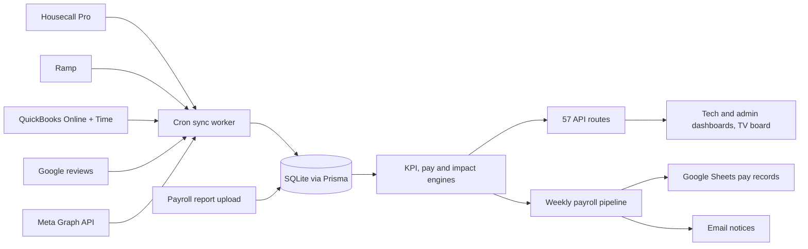

# Performance Center: KPIs, job attribution and weekly payroll for field technicians

> **Status:** Archived; ran in production February–September 2026 · **Built:** February–September 2026, 110 commits · **Stack:** Next.js 14, React 18, TypeScript, Prisma 5, SQLite, NextAuth, node-cron, PM2 · **Source:** archived (not linked)

## The problem

Honey Go Fix It (HGFI) is a plumbing and home-services company in Dayton, Ohio, that I co-founded and run the software and finance for. Technician pay depended on commission math done in spreadsheets, pulling from jobs and estimates in Housecall Pro, timesheets in QuickBooks Time, payroll in QuickBooks Online and card spending in Ramp. Nothing reliably recorded who sold, installed or helped on each job, and technicians had no single place to see their own numbers.

## What I built

A full-stack performance and payroll platform. It syncs field-service, card-spend, timesheet and payroll data into one database, then computes each technician's KPIs, commissions, weekly pay and per-person P&L. Technicians signed in with their company Google account to see their own numbers (about 18 KPIs) and a team leaderboard that also ran on a wall-mounted TV. Admins used it daily to review attribution and weekly to run payroll.

- **My KPIs, My Jobs, My Estimates, My Pay** with drilldowns, period presets and pay disputes
- **My Impact:** a per-technician P&L built from payroll actuals and job costing
- **Daily Review:** admins correct who led, helped or sold on each job, and corrections survive resyncs
- **Two-phase weekly payroll** with validation checks and per-employee pay records in Google Sheets
- **Job costing** that links card purchases to jobs automatically
- **Career ladder** with checklist sign-offs, time off, a learning center and suggest-only quality tagging

## Architecture

- **Sync layer.** One client and sync engine per source, each upserting into Prisma and keeping the raw JSON. A PM2 worker ran 9 scheduled jobs: nightly and 6-hourly syncs, the Monday payroll pipeline and twice-daily data-review reminders.
- **Domain engines.** A KPI engine of about 2,000 lines, pay and departmental payroll engines, a per-technician impact (P&L) engine, time off, payroll validation checks and quality metrics, served by 57 route handlers and 41 pages.
- **Auth.** NextAuth with Google OAuth, locked to the company's Workspace domain; admin, viewer and technician roles; admins can "view as" any technician; a Google device flow signs in the TV leaderboard.
- **Hosting.** One Linux server with nginx and TLS in front of Next.js, PM2 running the web app and the sync worker, and a database backup with an integrity check every 4 hours.

## Engineering highlights

- **Attribution rebuilt on real dispatch data.** Jobs and estimates carry lead, helper and seller positions seeded from the field-service dispatch order. Admin overrides persist across resyncs, an append-only audit log records every change, and revenue is split into sold, service, install, helped and turnover per technician so that team totals reconcile exactly to company totals.
- **A silent link bug, found and fixed.** The Housecall Pro API's "original estimate" pointer refers to an estimate *option* id, not the estimate id, so seller detection had never fired. A fallback match plus a backfill script relinked the historical jobs.
- **Two-phase payroll.** Phase 1 runs every Monday: sync every source, compute weekly pay, and run a registry of validation checks graded as blockers or warnings. Phase 2 is admin-triggered, refuses to finalize while any blocker is open, then writes pay records and accrues time off.
- **Many compensation models, one engine.** Greater-of hourly versus commission, hourly plus tiered per-job commission, crew pools, a grandfathered legacy plan alongside new department plans, commission earned only when collected, advances and chargebacks. The new payroll engine ran in **shadow mode** beside live pay before cutover, and a parity harness diffed old and new engine output over real data before any change to pay math shipped.
- **Self-healing job costing.** A matcher links Ramp card purchases to jobs by the job number in the memo, including sub-job suffixes. It re-runs on every sync, so a corrected memo links itself.
- **Timezone correctness.** Date-only rows written in different timezones are bucketed by "nominal day". I documented an ICU quirk where production Node formats midnight as hour 24 and kept week keys self-consistent rather than silently duplicating payroll weeks.
- **Deploys with automatic rollback.** The deploy script builds into a staging directory while the old build keeps serving, swaps atomically, does a graceful PM2 reload (about a 2-second blip), health-checks, and rolls back to the previous build if the check fails.
- **Access and privacy.** Admin rights come only from an allowlist, so a mis-set database role can't escalate. Pay stays private between technicians while jobs and KPIs are open to the team. A query cleanup (N+1 fixes and indexes) made pages about 10x faster.

## By the numbers

| Metric | Value |
|---|---|
| Time in production | February – September 2026 |
| Commits | 110 |
| Prisma models | 46 |
| API routes / pages | 57 / 41 |
| Unit tests | ~154 cases in 11 Vitest files |
| TypeScript and TSX | ~40,600 lines |
| Data sources synced | 5 (Housecall Pro, QuickBooks, Ramp, Google, Meta) |
| Scheduled jobs | 9 |
| Page speed after query cleanup | about 10x faster |
| Deploy interruption | about 2 seconds, with automatic rollback |

## Tech stack

- **Languages:** TypeScript, shell
- **Frameworks:** Next.js 14 (App Router), React 18, Tailwind CSS 3, Recharts, Zod, date-fns
- **Data:** Prisma 5 on SQLite in WAL mode, raw source JSON kept alongside normalized rows
- **Integrations:** Housecall Pro, QuickBooks Online (OAuth 2 with token refresh), QuickBooks Time, Ramp, Google (OAuth, device flow, Sheets, Places), Meta Graph API, Resend
- **Infra:** Linux server, nginx with Let's Encrypt TLS, PM2 web and worker processes, node-cron, scripted deploys with health checks and rollback
- **Testing:** Vitest on the pay, payroll, KPI, impact, attribution and job-matching engines, plus a parity harness for pay-math changes

## How it was built

Its ancestor was Performance-Center-2.0, a 2025 Flask dashboard of technician KPIs and my first business tool. Version 1 of this app went from first commit to production payroll in eight weeks (February to April 2026, 37 models and 39 routes). Version 2 (June–July 2026) added the departmental payroll engine in shadow mode, the attribution model rebuilt on dispatch data, the per-technician P&L, near-zero-downtime deploys and a security and performance overhaul, ending at 46 models and 57 routes. I set the business rules, wrote the specs and acceptance checks, and checked engine output against the source systems; most commits were co-authored with Claude Code. The app was retired when HGFI moved to ServiceTitan in September 2026.

## What I'd do next

- Start on PostgreSQL with hand-checked migrations instead of a single-file database, as the later HGFI Tools suite does.
- Make every business rule, including pay plans, a setting with version history rather than code.
- Keep shadow mode and parity diffs as the default for any change that touches money.
