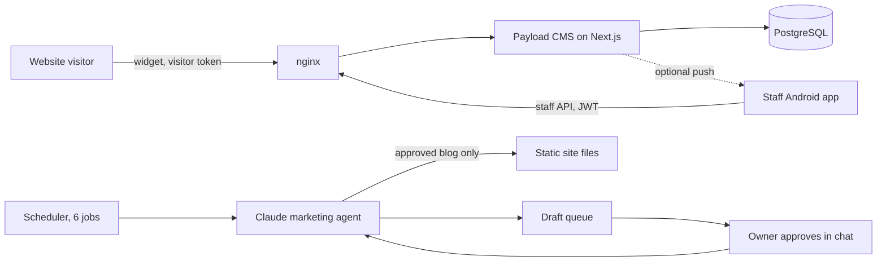

# Owning the Website: self-hosted CMS, in-house live chat and an approval-gated AI marketing agent

> **Status:** Prototype, staged on a test server, not cut over · **Built:** August 2026, 5 commits across 4 repos · **Stack:** Payload CMS 3, Next.js 16, PostgreSQL, Capacitor 7, Firebase Cloud Messaging, nginx, systemd, Anthropic Claude · **Source:** private (closed source)

## The problem

Honey Go Fix It (HGFI) is a plumbing and home-services company in Dayton, Ohio, that I co-founded and run the software and finance for. Its website, lead intake and much of its routine marketing ran on a hosted platform the company rented rather than owned. In August 2026 I prototyped moving the website and lead intake in-house.

## What I built

Four pieces, built as one effort: a Payload CMS 3 backend on Next.js 16 and PostgreSQL holding the content model the site would move to; a customer live chat that visitors start without an account; a small Android app for office staff to answer it; and an AI agent that drafts marketing content on a schedule and waits for a per-item human approval. I also built crawl, cleanup and versioning tooling that captures the company site as diffable snapshots.

- **Website chat:** a bubble with an intake form and consent checkbox, embedded in any page
- **Staff queue:** open, waiting, closed and spam views, with tap-to-call and unread badges
- **CMS admin:** pages, posts, media, SEO and redirects, scoped by role
- **HGFI Chat app:** an Android client for the staff API, with local notifications and optional push
- **AI marketing agent:** blog posts, social posts, Google Business Profile posts, review replies and newsletters, each approved one at a time in a chat channel

## Architecture

- **Visitor API** (start, send, poll). Starting a chat mints a 32-byte random token; the browser keeps it and the server stores only its SHA-256 hash.
- **Staff API** (7 endpoints). Payload JWT auth: the queue by status, messages with mark-read, send, status changes and device-token registration.
- **Collection hooks** keep each conversation's last-message preview and unread count current, and delete a thread's messages with it, because the Postgres adapter emits no `ON DELETE CASCADE`.
- **Hosting.** A systemd unit running as an unprivileged user bound to loopback, behind nginx. The app's database role owns only its own database, and migrations are the source of truth.
- **Agent.** A file-based queue (pending, approved, published or rejected), one Markdown file per item with frontmatter. Five skills and six scheduled jobs run on an agent gateway (OpenClaw) with Anthropic Claude; Telegram is the approval channel.

## Engineering highlights

- **Anonymous sessions that survive a database leak.** The server keeps only token hashes, so a copy of the database can't be replayed to impersonate visitors.
- **Field-level access control.** The template's "any signed-in user can do anything" model became admin, editor and support roles. Collection rules alone would let a support user PATCH themselves to admin, so the `role` field has its own rule. Access functions return query constraints rather than booleans, so guessing IDs against the REST API returns nothing.
- **A widget the host page can't break, and bots can't flood.** The widget is 592 lines of dependency-free JavaScript in a Shadow DOM, so the site's CSS can't touch it. Public routes have per-IP chat limits, per-conversation message limits, a size cap, and a honeypot field that silently routes bots to a spam queue.
- **Simple, documented delivery.** Messages arrive by polling (2.5 seconds while a chat is open, 20 in the background), which survives proxies, network changes and backgrounding without a reconnect protocol. Push calls Firebase Cloud Messaging's HTTP v1 API directly (one signed JWT, one POST) instead of the admin SDK, and stays dormant until credentials exist.
- **Safe-by-default operations.** nginx blocks `.git` anywhere and marks every response `noindex` unless the host is the real domain, so staging can't be indexed and production needs no change at DNS cut-over. A config sync script refuses to install if `nginx -t` fails.
- **A staff app built to outlive the move.** The server address is entered at sign-in rather than compiled in, so the same APK works before and after the domain moves. I traced a silent login stall to a Capacitor plugin promise that never settled without a bundler and replaced it with synchronous `localStorage`.
- **Approval by construction.** The agent may draft anything but publish only one thing itself: an approved blog post, written into the static site with the sitemap and structured data updated and links verified. Every other channel ends with a person holding the login, and approvals are per item, never inferred or bundled.
- **Red lines and a learning loop.** Text inside web pages and reviews is treated as data, never as instructions, as a defense against prompt injection. Other red lines ban invented prices or claims, customer personal data and unsafe emergency advice, with a specific rule for gas-smell calls. Revise and reject feedback is distilled into the agent's memory so drafts converge on the house voice, and reviews of 3 stars or below reach the owner the same day.

## By the numbers

| Metric | Value |
|---|---|
| Repos / commits | 4 / 5 |
| Custom backend code on the Payload template | ~2,600 lines |
| Chat widget | 592 lines, zero dependencies |
| Staff app | ~760 lines of JavaScript, ~3 MB APK |
| Visitor / staff API endpoints | 3 / 7 |
| Database tables at the migration baseline | 69 |
| Agent | 5 skills, 6 scheduled jobs |
| Custom end-to-end scripts | 2 (real widget in a DOM, staff app UI) |

## Tech stack

- **Languages:** TypeScript, JavaScript, SQL, Bash, Python, Markdown agent policy
- **Frameworks:** Payload CMS 3, Next.js 16, React 19, Lexical, Tailwind, Radix UI, Capacitor 7 (vanilla JavaScript, no build step)
- **Data:** PostgreSQL with authoritative migrations and a least-privilege app role
- **Integrations:** Firebase Cloud Messaging (HTTP v1), Anthropic Claude through OpenClaw, Telegram
- **Infra:** nginx, systemd, a signed release APK built, verified and published by script
- **Testing:** the template's Vitest and Playwright tests, plus two custom end-to-end scripts

## How it was built

I built this in August 2026. I wrote the threat model (anonymous visitors, role escalation, abuse, staging leaks), the agent's authority and red lines, and the cut-over plan, and shipped the code with Claude Code as my pair programmer; all three commits with custom code are co-authored with Claude. The stack was staged on a test server and never cut over to the live domain. The idea of AI drafts that wait for a person's approval carried into the company's later in-house marketing platform ([case study 10](10-marketing-platform.md)).

## What I'd do next

- Move rate limiting to Redis and chat delivery to server-sent events before running more than one app instance.
- Turn on background push for the staff app and publish it through a managed store instead of sideloading.
