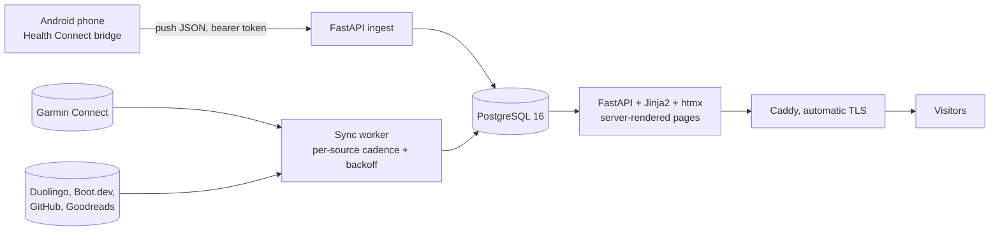

# shaynhornik.com: a public dashboard of my health, training and learning data that updates itself

> **Status:** Live in production at [shaynhornik.com](https://shaynhornik.com) · **Built:** July–October 2026, 11 commits · **Stack:** Python, FastAPI, PostgreSQL 16, SQLAlchemy 2, Jinja2 + htmx, Docker Compose, Caddy · **Source:** private (closed source)

## The problem

My health and learning data was spread across half a dozen apps. Workouts and weigh-ins were on a Garmin watch, meals in a nutrition app, sleep and heart rate on my phone, and my progress on Duolingo, Boot.dev, GitHub and Goodreads. None of them gave me one public page to hold myself accountable to. I wanted a dashboard that keeps itself current. The only manual work should be logging meals and recording workouts.

## What I built

It's a self-hosted data platform. It pulls from six feeds, normalizes the data into Postgres and publishes it as a live public site. My phone pushes its data to the server about every 15 minutes, and a dedicated sync worker pulls everything else on a schedule. The pages weren't the hard part. The hard part was getting data from overlapping sources to add up correctly. It now runs on a free-tier VM, and hosting costs nothing.

- **Food explorer:** 7, 30 and 90-day ranges, a macro split and drill-down for each day, and a top-foods leaderboard
- **Workouts:** an activity list where each strength session drills down to sets, reps and weight
- **Sleep, weight and vitals:** sleep stages and scores, a weight trend, and 6 vitals tiles plus 5 charts covering stress, body battery, SpO2 and HRV
- **Learning:** Duolingo streak and XP; Boot.dev level, XP and achievements; a GitHub contribution heatmap and language bar; Goodreads shelves
- **Projects:** my merged open-source pull requests (currently eight, across four upstream projects), refreshed daily from GitHub
- A home dashboard with stat tiles and a freshness chip for each source, plus a contact form and a social preview image

## Architecture

- **Push ingest:** an open-source Android bridge app forwards Health Connect records to an authenticated endpoint. Those records include nutrition logged in MacroFactor, sleep stages, steps, heart rate and HRV.
- **Pull sync worker:** one container runs each source on its own schedule (every 6 hours by default), backs off for an hour on a rate limit, re-checks missing credentials every 5 minutes, and logs every run.
- **Postgres:** 29 tables. Health data is deliberately stored twice: as raw interval tables (heart rate, HRV, respiration, steps, calories, distance) and as daily rollups recomputed from them. Any total can be rebuilt from the raw data.
- **Web app:** FastAPI renders 23 Jinja2 templates on the server, with htmx and no SPA build. My own small SVG library draws the charts.
- **Deploy:** Docker Compose runs Caddy, the app, the sync worker and Postgres. The deploy script creates missing secrets on the server itself, so none is ever committed.

## Engineering highlights

- **Cross-source de-duplication.** The same walk can arrive from both Garmin and Health Connect, and the bridge adds up distance across sources. An interval-sweep algorithm counts overlapping time only once. Sessions that overlap by more than half of the shorter one are merged, and the more specific workout type and the row with more calorie data win. Distance is recomputed from the raw intervals instead of taken on trust. On one hike this cut the reported 9.31 mi to 5.61 mi, which matched the watch exactly.
- **Ingest built around the sender's watermark.** For each data type, the bridge moves a watermark forward on any 200 response and never resends. A premature "200 OK" would lose data permanently. So the server parses and stores every record type before it acknowledges, and the documented recovery path is a re-sync over a date range.
- **Garmin authentication.** Garmin rate-limits and rejects the usual community login library. I switched to a client with a standard TLS fingerprint to mint tokens once, and the server makes its API calls with those tokens. I backfilled two years of history.
- **Hand-written SVG charts.** 161 lines of JavaScript draw line and bar charts with crosshair tooltips and round-number axis ticks (steps of 1, 2, 2.5, 5 or 10). Colors come from CSS custom properties, so dark mode needs no extra code. There's no charting dependency.
- **Idempotent bulk writes.** Rows are upserted 2,000 per statement on composite natural keys, so any time window can be re-synced safely. Schema changes are `ALTER … IF NOT EXISTS` statements that run at startup.
- **Cost engineering.** The whole stack fits in about 240 MB of RAM. In October 2026 I moved it from a paid droplet to a free-tier Google Cloud VM and a free-tier LLM API (Gemini, with a chain of fallback models). Hosting now costs nothing.

## By the numbers

| Metric | Value |
|---|---|
| Data feeds on the public site | 6 (Garmin, Health Connect, Duolingo, Boot.dev, GitHub, Goodreads) |
| Python | ~4,100 lines |
| Server-rendered templates | 23 |
| Postgres tables | 29 |
| Chart library | 161 lines, zero dependencies |
| Garmin history backfilled | 2 years |
| Phone push cadence | ~15 minutes |
| Memory footprint of the full stack | ~240 MB |
| Monthly hosting cost | zero (free-tier VM and free-tier LLM API) |

## Tech stack

- **Languages:** Python, HTML/Jinja2, JavaScript, SQL
- **Frameworks:** FastAPI, SQLAlchemy 2.0, Jinja2, htmx
- **Data:** PostgreSQL 16 via psycopg 3; raw interval tables plus recomputed daily rollups
- **Integrations:** Garmin Connect, Android Health Connect (through an open-source webhook bridge), MacroFactor, Duolingo, Boot.dev, GitHub, Goodreads, Gemini API
- **Infra:** Docker Compose, Caddy with automatic Let's Encrypt, Google Cloud free-tier VM, rsync deploy script
- **Testing:** no automated suite yet; I verified with headless-Chrome screenshots and by checking totals against the source apps

## How it was built

Most of it came together in two long sessions at the end of July 2026. Work from my laptop was merged in during September, and the hosting move came in October. I designed the data model, the de-duplication rules and the ingest contract, and I decided what is public. I also checked the numbers against the source apps. Claude Code wrote most of the code, working as my AI pair-programmer.

## What I'd do next

- Add an automated test suite around de-duplication and the rollups, using the hike that exposed the distance bug as the first fixture.
- Raise an alert when a feed goes stale instead of relying only on the freshness chip.
