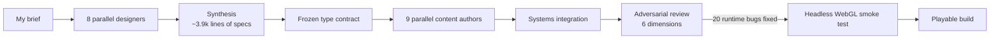

# Games and simulations: AI-orchestrated RPGs, an original puzzle game, a company arcade and a plumbing code trainer

> **Status:** 1 company arcade deployed, 4 prototypes · **Built:** March–September 2026 (arcade: 9 commits; the prototypes are local builds) · **Stack:** TypeScript, JavaScript, Three.js, WebXR, Unreal Engine 5.8, Blender Python, Vite, Playwright · **Source:** private (closed source)

## The problem

Two questions drove this work. How far can coordinated AI agents take a large, stateful program like a 3D open-world RPG when a human sets the design and the contracts? And can games do real work for Honey Go Fix It (HGFI), the plumbing and home-services company in Dayton, Ohio that I co-founded, by engaging customers and training field technicians on the plumbing code?

## What I built

Five projects. I wrote each brief or design and set the acceptance bar; AI coding agents wrote most of the code, as noted below.

- **WYRMFALL:** a first-person open-world action-RPG in the browser. It recreates the systems of a famous Nordic open-world RPG with 100% original lore. Claude Code agents built it in one day against a frozen type contract.
- **Ashen Realms:** the same brief given to a different agent (OpenAI Codex CLI) on the same day, for a side-by-side comparison.
- **The Scribe's Hall:** my own original design, a first-person, non-combat puzzle game in a buried ziggurat where real ancient mythology (Sumer, Egypt, Canaan, Persia) is the puzzle logic. Claude Code built it from my design documents.
- **HGFI arcade:** two branded, mobile-first browser games (Whack-a-Leak and Flush Rush) with global leaderboards, built with AI pair-programming from my brief.
- **Ohio DWV Trainer:** a 3D drain-waste-vent trainer for plumbing apprentices, aligned to the Ohio Plumbing Code and ready for WebXR. OpenAI Codex CLI built it from my brief.

## Architecture

How WYRMFALL was built:

- **Contract first:** `types.ts` is the single source of truth and imports nothing from Three.js, and every balance constant lives in one file. Freezing it before any content was written let nine agents write data registries in parallel and still integrate cleanly. Systems (terrain, combat, magic, enemy AI, quests, saves) live in separate modules on a typed event bus.
- **The Scribe's Hall in three engines:** a stalled Godot 4 shell; a complete Three.js Level 1 (27 ES modules, no build step); and an Unreal Engine 5.8 whitebox of all four halls. The Unreal build was driven through an editor MCP bridge from Linux (WSL) to the Windows editor.
- **Arcade:** static game bundles share a brand stylesheet, a Web Audio module and a score client; a small Fastify + SQLite server sits behind Caddy.
- **DWV trainer:** the 3D scene, lesson rules, isometric SVG view and code references are separate modules, so licensed code text can be added later.

## Engineering highlights

- **Adversarial review catches what type-checks miss.** After integration, a review workflow probed the build along six dimensions and found 20 runtime bugs, all of them fixed. Among 33 Vitest tests, a content-integrity test checks every cross-reference between data files (loot to items, quests to NPCs).
- **Headless WebGL smoke harness.** Playwright drives Chromium with software WebGL (SwiftShader) against the production build. It clicks New Saga, plays, moves and opens menus, asserts zero console or page errors and saves a screenshot. Ashen Realms has a similar verifier on the raw Chrome DevTools Protocol that also samples canvas pixels.
- **Same brief, two agents.** The multi-agent pipeline produced about 10.5k lines of typed, tested code; the single agent produced a lighter 3.4k-line JavaScript prototype. The comparison showed what the extra structure buys.
- **Driving Unreal from an AI session.** Blueprint graphs were written programmatically in a Lisp-like DSL through the MCP bridge. One sphere trace classifies its hit (a carved relief means "read", a physics-simulating component means "grab"), which fixed a bug where the player grabbed floor geometry. To debug the headless editor, the agent spawns a probe Blueprint, runs Play-In-Editor and greps the log.
- **Procedural art pipeline.** Headless Blender `bpy` scripts generated 27 props and a rigged 23-bone character, exported to Unreal as FBX with convex collision.
- **A fairness rule for Flush Rush.** The time a jump keeps the player above obstacle height must be longer than the time an obstacle overlaps the player's collision box. Otherwise no timing can clear it. Early tuning broke this rule, so jump, gravity and dive constants were retuned against it. All sound is synthesized with Web Audio, with no audio files.
- **Domain rules as data.** At each DWV station the trainee picks a fitting pattern, drain grade, venting method, trap arm, cleanout or vent termination. A live validator scores the choice and logs each issue with its fix, and the isometric drawing redraws from the same choices. It links to the official Ohio Administrative Code instead of copying copyrighted tables, with 7 hooks for Ohio's 2024 vent amendments.

## By the numbers

| Metric | Value |
|---|---|
| WYRMFALL TypeScript | 10,504 lines in 49 files (3,880 are data registries) |
| WYRMFALL content | 86 perks, 19 spells, 57 gear items, 47 consumables, 27 recipes, 15 enemies, 12 NPCs |
| WYRMFALL tests | 33 (Vitest) |
| Scribe's Hall, Three.js Level 1 | 27 modules, 3,346 lines |
| Scribe's Hall, Unreal whitebox | ~507 actors, a ~294 m climb, 14 materials |
| Blender procedural assets | 27 props + a 23-bone rigged character |
| Arcade | 2 games, ~1,950 lines of JavaScript |
| DWV trainer | 2,141 lines of TypeScript, 4 lessons, a 19-module roadmap |

## Tech stack

- **Languages:** TypeScript, JavaScript, Python (Blender), GDScript, Unreal Blueprints
- **Frameworks:** Three.js, WebXR, Unreal Engine 5.8, Godot 4, Vite, Fastify 4
- **Data:** versioned localStorage saves, SQLite (WAL) leaderboards
- **Integrations:** an Unreal editor MCP bridge, Blender `bpy`, the Web Audio API
- **Infra:** Caddy, systemd, static builds
- **Testing:** Vitest, Playwright with SwiftShader for headless WebGL, Chrome DevTools Protocol verifiers

## How it was built

All five were built between March and September 2026; WYRMFALL and Ashen Realms on one day in June. I designed and directed WYRMFALL's pipeline (design, contract, content, review), and Claude Code agents carried it out. The Scribe's Hall is my own design: a full design document, three pillars ("Mastery Through Observation", "Tactile Archaeology", "The Weight of Ages") and a detailed Level 1. Claude Code implemented it. Ashen Realms and the DWV trainer were built with OpenAI Codex CLI. The trainer is a training scaffold, not compliance advice.

## What I'd do next

- Publish WYRMFALL as a static build so it can be played from this page.
- Grow the DWV trainer beyond its 4 starter lessons along the 19-module roadmap, and test it in a VR headset.
