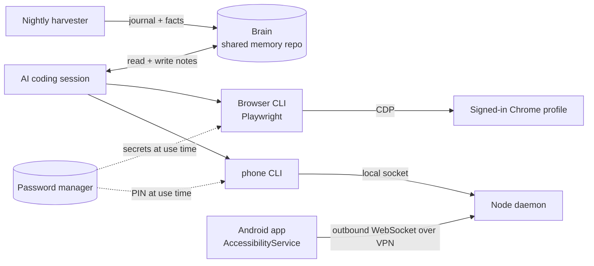

# Agent tooling: memory, browser and phone control for my AI coding agents

> **Status:** Brain, the browser toolkit and Phone Remote in daily internal use; OpenClaw Remote dormant · **Built:** February–October 2026, 20 commits across three repos (the browser toolkit is untracked) · **Stack:** Python, Node.js, Playwright, Chrome DevTools Protocol, Kotlin/Android, React 19, TypeScript · **Source:** private (closed source)

## The problem

I run much of Honey Go Fix It's (HGFI) software and back-office work through AI coding agents. Out of the box they forget everything between sessions and machines, they can't use web apps or a phone the way a person does, and handing them credentials is risky. I built the infrastructure that closes those gaps, with guardrails I trust.

## What I built

Four pieces, each giving an agent something a person takes for granted:

- **Brain:** shared long-term memory for every AI coding session on every machine, maintained overnight.
- **Browser toolkit:** a CLI that lets an agent drive a real, signed-in Chrome profile over the Chrome DevTools Protocol. Secrets come from a password manager at the moment they're used.
- **Phone Remote:** an Android app and a desktop daemon that let an agent read and operate my phone over a private VPN, gated and fully audited.
- **OpenClaw Remote:** a React 19 PWA, installed as a gateway plugin, for monitoring and steering a self-hosted AI-agent gateway from a phone.

## Architecture

- **Brain:** every project's memory folder is symlinked to one git-synced store. A nightly Python harvester reads the day's session transcripts, has a headless AI session write a journal entry and promote lasting facts into indexed notes, then scans for secrets, commits and syncs.
- **Browser toolkit:** a stateless Playwright CLI attaches to a dedicated, persistent Chrome automation profile on Windows, bridged from Linux (WSL) through a port forwarder. Site-specific drivers are built on top of it.
- **Phone Remote:** the phone dials out to the desktop, so the phone itself opens no listening port. The CLI talks to the daemon over a local Unix socket, and the daemon holds the single WebSocket link.
- **OpenClaw Remote:** the plugin serves the built app from the gateway's own origin, so there's no CORS, proxy or extra port.

## Engineering highlights

- **Memory that maintains itself, safely.** Per-transcript watermarks mean each run reads only what's new; character budgets per session and per batch bound the cost, and digests drop tool noise. A regex secret scanner blocks the commit on any match, a lock file prevents overlapping runs, and pull-rebase-push sync lets the desktop and laptop both write. Transcripts expire after 30 days by design; what's worth keeping survives as a note.
- **A browser CLI built for agents.** Every command (tabs, navigate, screenshot, text, click, fill, evaluate, upload, downloads, history, frames) is stateless, so an agent can work step by step without holding a session open. Drivers on top download statements, attach receipts to expense transactions and read order history. A receipt-recovery pipeline searches email, renders the HTML receipt to a PNG in the browser, uploads it to the matching transaction and re-checks the receipt count.
- **Secrets never reach the transcript.** Credentials, including the phone PIN, are fetched from a password manager's CLI at the moment of use and never printed. The audit log masks the PIN and password-field text.
- **Hand-written RFC 6455 on both ends.** Neither side uses a WebSocket library. The Node side is a ~100-line frame parser that handles fragmentation, control frames, 16- and 64-bit extended lengths, a 32 MB cap and unmasking. The Kotlin side is a raw-socket client that masks every frame with a secure random key. Screenshots travel as large frames, so tests feed the 64-bit length path in chunks.
- **Defense in depth on the phone link.** The daemon binds only to the VPN interface and accepts a connection only with the shared token and from the phone's VPN address. Tokens are compared as SHA-256 hashes in constant time; on the phone the token is encrypted with a non-exportable, hardware-backed AES-256-GCM key in the Android Keystore. Nothing runs until I switch it on. 16 unit tests cover framing, the token check and audit masking.
- **Phone control through accessibility, not root.** A Kotlin AccessibilityService reads the UI tree, taps by label or coordinate, types, takes screenshots, opens apps, and wakes and unlocks the phone. A foreground service reconnects indefinitely and restarts after a reboot; if the app is offline, the CLI falls back to adb over the VPN.
- **Cryptographic device identity for the dashboard.** In OpenClaw Remote, each browser or phone generates an Ed25519 keypair and signs its connection payload under the gateway's WebSocket protocol v3. The plugin's static server blocks path traversal, sets security headers, and caches hashed assets as immutable but never `index.html`. 76 tests cover the protocol, device auth, the HTTP server and the stores.

## By the numbers

| Metric | Value |
|---|---|
| Brain harvester | ~300 lines of Python, runs nightly |
| Brain memory notes | ~100 |
| Browser toolkit drivers | ~2,100 lines of JavaScript |
| Phone Remote | ~1,230 lines of Kotlin + ~800 lines of Node, first version built in one day |
| Phone Remote tests | 16 (10 Node, 6 Kotlin JUnit) |
| OpenClaw Remote | ~8,100 lines of TS/TSX, 12 views, 10 Zustand stores |
| OpenClaw Remote tests | 76 in 14 files |

## Tech stack

- **Languages:** Python, JavaScript (Node.js), Kotlin, TypeScript/TSX, Bash
- **Frameworks:** playwright-core, Android SDK (AccessibilityService, foreground service, Keystore), React 19, Vite 6, Zustand 5, Tailwind CSS 4, Recharts, CodeMirror 6
- **Data:** git as the memory store, Markdown notes, append-only audit logs
- **Integrations:** Chrome DevTools Protocol, Claude Code in headless mode, a password manager CLI, adb, the OpenClaw gateway's WebSocket protocol v3
- **Infra:** systemd user services, cron, a private mesh VPN, a WSL-to-Windows bridge, PWA via Workbox
- **Testing:** Vitest 3 + Testing Library, JUnit, a dependency-free Node test runner

## How it was built

OpenClaw Remote came first, in February 2026; it was published under MIT at the time, and that public repository has since been taken down. The browser toolkit grew through September as I gave agents more of the company's back-office work. Phone Remote and Brain were each first built in a day in early October; Brain now commits nightly. I set the requirements and the security model: where secrets live, what gets logged, and what is allowed to listen where. Claude Code wrote most of the code.

## What I'd do next

- Republish OpenClaw Remote as a public repo with working install instructions.
- Split the general browser CLI into an open-source tool and keep the site-specific drivers private.
