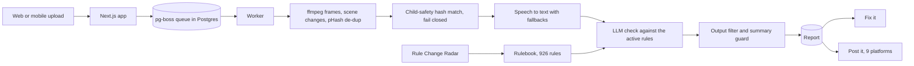

# FYProof: check a video against every platform's rules before you post it

> **Status:** live public beta with paid plans · **Built:** October 2026, with a partner, as a side project · **Stack:** Next.js 16, React 19, PostgreSQL 17, pg-boss, ffmpeg, Stripe, Expo · **Source:** private (closed source) · **Site:** [fyproof.com](https://fyproof.com)

## The problem

Creators, agencies and brands lose videos after they post them: removed, age-restricted, demonetized or quietly
down-ranked, often for a rule they never saw. Each platform publishes its own policies in its own places, changes them
without notice, and enforces them differently. Nobody can read ten rulebooks before every post. FYProof is a side
project I build with a partner, separate from Honey Go Fix It, made to answer one question before you hit publish: what on this video could
get it in trouble, where, and how do I fix it?

## What I built

A web app where you upload a video with the caption and hashtags you plan to use, pick your platforms, and get back a
timestamped report: each flag with its platform, likely consequence, confidence, the rule's source and a fix. Reports
are framed as risk estimates, never guarantees, and the code enforces that framing. It covers TikTok, YouTube,
Instagram, Facebook, X, Threads, Snapchat, Pinterest and LinkedIn.

- **Check:** frames, scene changes, speech and on-screen text checked against a sourced, versioned rulebook of 926 rules
- **Fix it:** cut, blur a confirmed region, mute a range, add a label or normalize loudness, then re-check before and after
- **Post it:** posting adapters for nine platforms, each switched on as that platform's app review clears
- **Rule Change Radar:** watches every rule's source page and flags changes for the monthly rulebook update
- **Teams and agencies:** shared workspaces, batch checks and branded PDF reports, shareable receipts
- **Billing and account rights:** Stripe Checkout with plans and packs, data export and deletion, 72-hour video retention
- **Mobile:** an Expo app with a share-to-check extension (in development)

## Architecture

- **One Next.js app** serves the public site, the signed-in app and the admin site, chosen by host name.
- **A separate worker process** pulls jobs from a pg-boss queue in Postgres, so a slow video never blocks a web request.
- **A provider registry** puts the model, speech-to-text, moderation and hash-matching services behind pluggable
  adapters with fallbacks; switching a provider is an admin setting, not a deploy.
- **The rulebook is data:** YAML files per platform with a JSON Schema, archived source snapshots and a changelog. Each
  check loads only the rules for the platforms chosen.
- **PostgreSQL 17** with 38 migrations and about 84 tables, separate roles for the app and for migrations.

## Engineering highlights

- **Prompt-injection defense.** Everything a creator supplies (caption, transcript, on-screen text) is wrapped in
  random-boundary markers the text cannot close. Look-alike markers are neutralized, and the system instructions say
  marked content is material to judge, never instructions to follow.
- **Output you can trust.** An output filter strips invented URLs and leaked prompt fragments, and a summary guard
  rewrites any sentence that calls a video "safe", "compliant" or "clean", because the product only estimates risk.
- **Rules tied to their sources.** Every rule quotes its source. The Radar fetches each source page, snapshots and
  diffs it, re-verifies every quote against the live text, and triages what changed. CI fails if a rule breaks the schema.
- **Trust and safety before launch.** Child-safety hash matching runs before any frame leaves the server and fails
  closed; a match quarantines the upload and holds it for review. Abuse and DMCA flows, 18+ and US-only gates shipped
  with the beta, not after it.
- **Cost engineering.** Frames are de-duplicated by perceptual hash before analysis, prompts are cached per provider,
  rules are filtered per check, and spend caps apply per user and site-wide, with cost-per-check reporting.
- **Evals.** Labeled evaluation sets, a scorer, offline re-scoring of saved results, and an admin page that compares
  configurations side by side before one becomes the default.
- **Operations as code.** CI runs lint, type-check, rulebook, guard, copy and WCAG contrast checks, about 2,900 unit
  tests and a build, then packs a release and smoke-tests the worker from it. Deploys run migrations and health
  checks with automatic rollback; nightly backups get an automatic restore test.
- **Tests that own their database.** Each unit-test run starts and removes its own throwaway Postgres cluster, and the
  end-to-end suite runs against fake Stripe, social-platform and storage servers.

## Details

| Detail | Value |
|---|---|
| Rulebook | 926 rules across the platform rulebooks |
| Posting integrations | 9 platforms |

## Tech stack

- **Built with:** TypeScript, SQL, YAML
- **Frameworks:** Next.js 16 (App Router), React 19, Tailwind 4, Expo SDK 57 / React Native 0.86
- **Data:** PostgreSQL 17, pg-boss, S3-compatible object storage
- **Media and AI:** ffmpeg and ffprobe, perceptual hashing, multiple LLM and speech-to-text providers behind one registry
- **Integrations:** Stripe, posting APIs for nine social platforms (including atproto OAuth with DPoP for Bluesky), Sign in with Google
- **Infra:** DigitalOcean, Caddy, systemd, GitHub Actions
- **Testing:** Node test runner with per-run Postgres clusters, Playwright, fake third-party servers

## How it was built

I wrote the product spec, the rulebook research method, the trust-and-safety design and the acceptance checks, then
built it with Claude Code in coordinated sessions. It is in public beta with open sign-up and paid plans. What I owned was the product itself: what a flag must prove, what the report may and may
not claim, which safety checks run before anything else, and what has to be true before a deploy goes out.

## What I'd do next

- Ship the mobile app through store review, with share-to-check from the camera roll.
- Grow the labeled evaluation sets with real (consented) creator videos and publish accuracy by platform.
- Turn on the remaining posting integrations as each platform's review clears.
