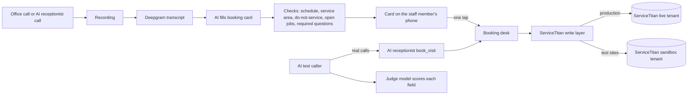

# Hands-free booking: from a live phone call to a ServiceTitan job, with an AI test caller as QA

> **Status:** in production since October 17, 2026; bookings and call notes write into the live ServiceTitan tenant, and every test site books into a ServiceTitan sandbox · **Built:** October 2026, across three of the suite's services · **Stack:** TypeScript, Next.js 16, PostgreSQL + Prisma, Claude (Haiku and Sonnet), Deepgram, Telnyx voice and AI Assistants, ServiceTitan API, Kotlin (Android) · **Source:** private (closed source)

## The problem

At Honey Go Fix It (HGFI), the plumbing and home-services company in Dayton, Ohio that I co-founded, every phone booking meant typing the same details twice: once while talking to the customer, then again into ServiceTitan. Missed fields, wrong phone numbers and double-booked windows came from that second step. The office wanted to be able to take a call anywhere ("at the grocery store", as one owner put it), ask the right questions, and let the software do the booking, with a nudge if something was wrong.

## What I built

Three pieces that share one booking path:

- **Booking cards from office calls.** After a call the office takes, the recording is transcribed and an AI fills in the booking from what was said: customer, address, problem, job type and business unit, the window agreed, the job summary and notes. The card is checked against the live schedule and ServiceTitan and explains in plain words what's wrong, with one-tap fixes: a full window (and the windows that do have room), a missing address, an address outside the service area, a do-not-service customer, an open job already on the customer, a question nobody asked. It is pushed to the phone of whoever took the call; one tap books the job and shows the job number. Nothing is booked without that tap, and a card can never book twice.
- **The AI receptionist books through the same desk.** When the AI receptionist (case study 07) takes a call, it uses the same booking desk: the same open windows, plumbers-per-day limits, service-area check and guarded ServiceTitan write.
- **An AI test caller as QA.** A second voice agent with its own voice phones the AI receptionist's test line as one of 18 made-up customers, unscripted. A judge model marks every field of the resulting booking against what was actually said.

## Architecture

- **One booking desk** in the marketing tool owns windows, capacity and the service-area check; the phone system and the AI receptionist both call it.
- **One write door** (case study 02) sends the job to ServiceTitan only when that kind of write is switched to live, a server-side lock is open, and the vendor permission exists.
- **Test equals sandbox, production equals real.** Every test site points at a separate ServiceTitan sandbox tenant with its own keys and database; the test deploy script refuses to run with production keys.

## Engineering highlights

- **Business rules live in settings, not code.** Which questions every booking needs, how the job type is chosen and how the summary is written are settings the office edits, with history. When the owners clarified that every booking is a free estimate (even for a repair), the rule changed on a screen, and the card's job-type choice followed the office manager's written call policy.
- **Test calls found real bugs before customers did** (from the AI test caller and from the owners calling in):
  - cards took the number the call came from instead of the "best number" the customer gave, so the card now uses the number said on the call and notes the calling number;
  - a caller who changed the day after booking could create two visits, so a changed time now replaces the first hold;
  - a hung-up call was treated as handled if a later call from the same number saved something, so now only what was saved during that call counts, and complaints are flagged for the office.
- **Idempotent bookings without vendor support.** A repeat booking for the same number and window (a dropped call, a second call) is recognized as "already booked" instead of failing or double-booking, and any changed details go to the office as a message. Each call carries its own call id into the write.
- **Calls become ServiceTitan notes.** After each finished call, the matched customer gets a short note in ServiceTitan (when, direction, who answered, talk time, reason and AI summary), so the CRM shows every conversation without anyone typing it.
- **Safe live proof.** Every new write path was proven with one labeled test record in the real tenant, read back and cancelled the same minute; all other testing happens in the sandbox.

## Details

| Detail | Value |
|---|---|
| Services involved | 3 (phone system, marketing tool's booking desk, ServiceTitan connection) plus the Android app |
| Write kinds behind switches | 5 (bookings, booking cards, call notes, receipt attachments, purchase orders) |
| AI test caller personas | 18 (8 safe for real calls, 10 text role-plays) |

## Tech stack

- **Built with:** TypeScript, Kotlin
- **AI:** Claude Haiku for card filling and the receptionist's turns, Claude Sonnet as the judge, Deepgram nova-3 two-channel transcripts
- **Integrations:** Telnyx Call Control and AI Assistants, ServiceTitan (jobs, appointments, notes, customers), Firebase Cloud Messaging for the card push
- **Data:** PostgreSQL with Prisma; every write logged with its request, answer and outcome

## How it was built

The owners described the goal in a sentence; I turned it into the rules (what a booking must check, what needs a human tap, which writes may go live and how they're proven), and Claude Code agents built the pieces across three repositories against those rules. The AI test caller was built to find problems a scripted test would miss.

## What I'd do next

- Measure card accuracy on real office calls each week and tune the prompts against the judge's scores.
- Let the card propose the earliest open window when the customer has no preference.
